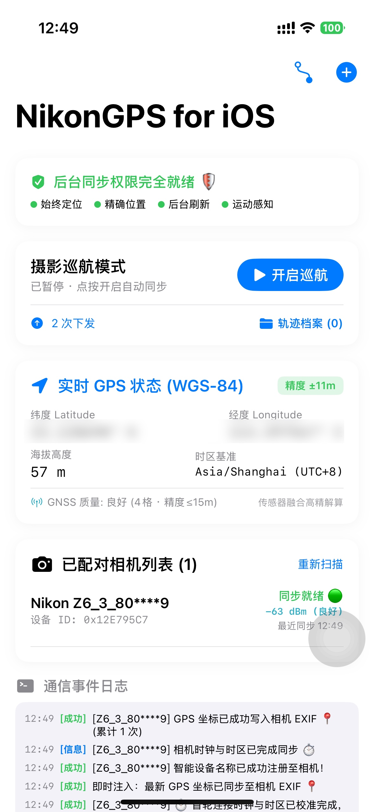
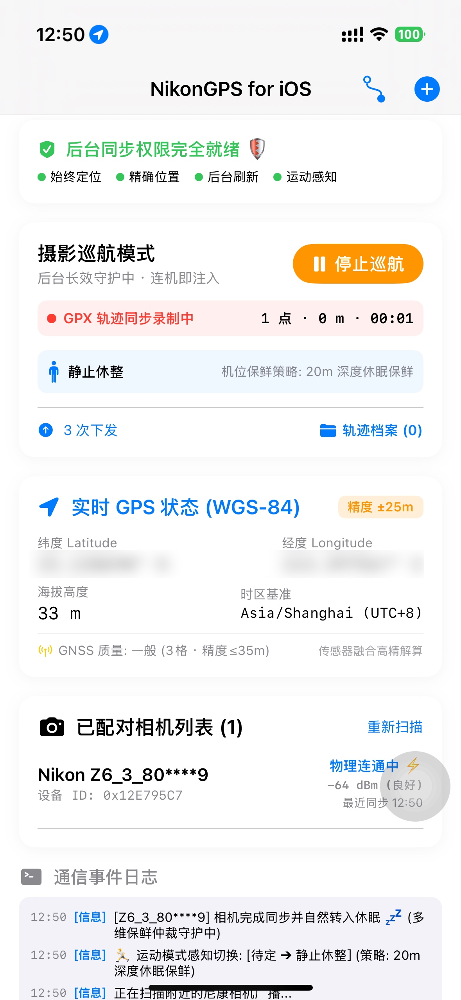
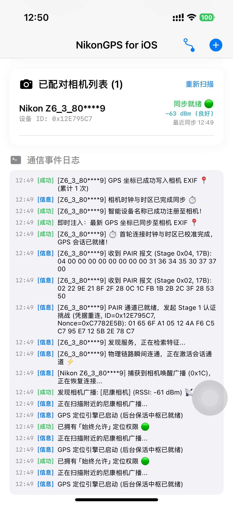
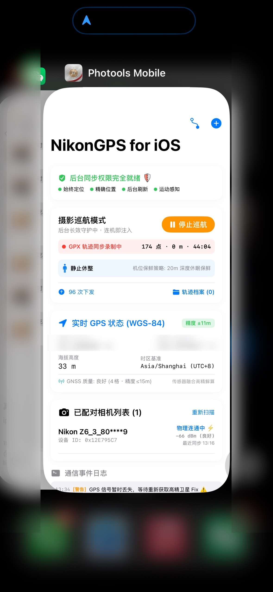
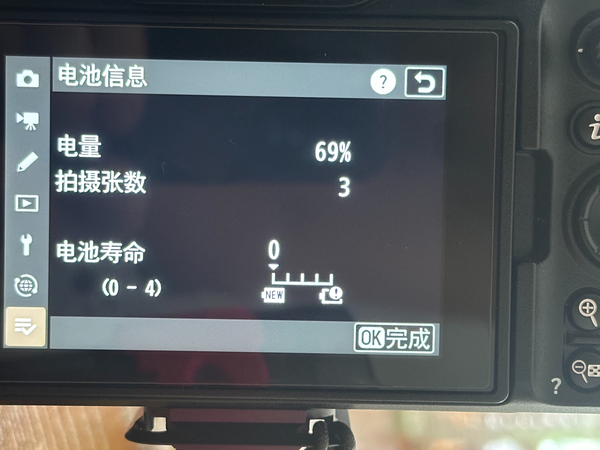
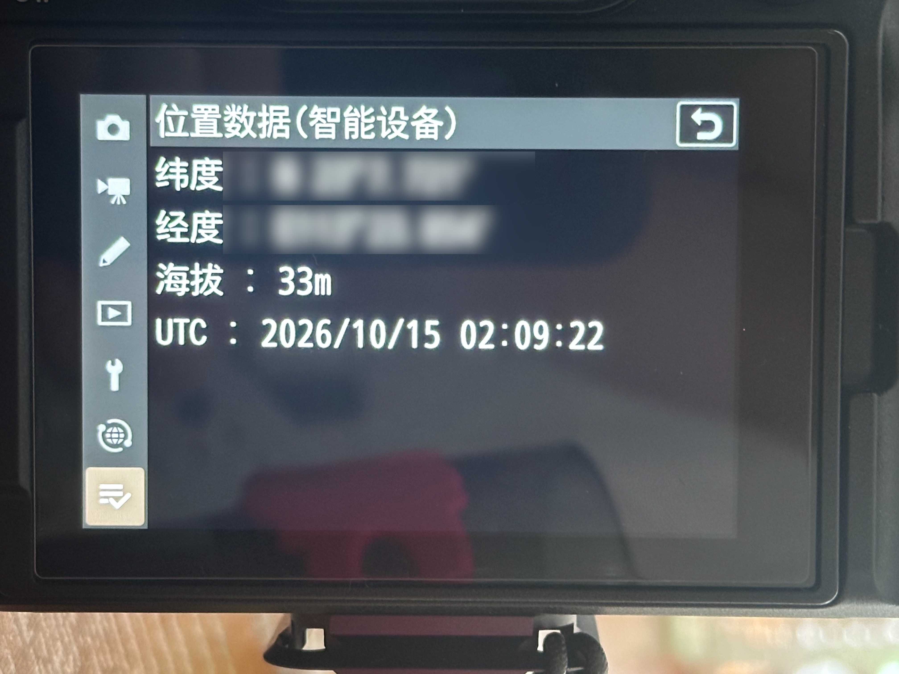

# 📸 photools

<p align="center">
  
</p>

<p align="center">
  <b>Turn your GPX tracks into GPS-tagged, location-aware photo libraries.</b><br/>
  <i>Automatic Geotagging, Intelligent Interpolation, Offline Reverse Geocoding & Date-Based Archiving for Photographers.</i>
</p>

<p align="center">
  <a href="README.md"><b>English</b></a> | <a href="README_zh.md"><b>简体中文</b></a>
</p>

<p align="center">
  <a href="https://github.com/vincentchyu/photools/releases/latest"></a>
  
  
  
  
</p>

---

## 💡 The Problem & The Story

As photographers who dual-wield multiple camera bodies in the wild, we have long suffered from a disjointed workflow—
**frustrating live geotagging in the field, followed by chaotic organization back at the desk**:

> *"On long trekking and landscape trips across Xinjiang or Western Sichuan, I shoot with dual Nikon bodies (e.g. Z8
telephoto + Z50 II / Z6 III wide-angle). In the **field**, Nikon's official SnapBridge is notoriously bloated: lock your
iPhone screen for 5 minutes, and iOS terminates the app in the background, killing GPS sync; the phone overheats and
battery plummets; it greedily hogs Wi-Fi and knocks out mobile cellular connectivity. Worst of all, **official
SnapBridge strictly limits you to a single active camera**—the secondary body never receives GPS, and the cameras'
internal clocks drift apart.*  
> *Then, in **post-processing**, facing 4,000+ RAW photos on memory cards from cameras without native GPS, one faces the
tedious chore of manually aligning GPX tracks from smartwatches, interpolating missing coordinates lost in deep canyons
or indoors, injecting standardized administrative location names into EXIF, and organizing them into clean date
directories—all while **adamantly refusing to upload private photos to any commercial cloud**!"*

**photools** was built to connect this entire loop from **field capture** to **post-processing archive**:

```text
【On-Field Capture · Mobile】
 iPhone (NikonGPS) Pure BLE Fast Sync ──▶ Concurrently injects GPS & UTC clock to multiple cameras + Background GPX logging
                                                         │
                                                         ▼ (Cards inserted into Mac after shoot)
【Post-Processing · Desktop】
 Memory Card RAW/JPGs + Hiking GPX ──▶ photools Desktop / CLI ──▶ Spherical great-circle interpolation + 3D KD-Tree geocoding + Date archive
```

---

## ✨ Real Transformation (Before vs After)

### 📱 1. On-Field Capture & Live Camera Synchronization

<table width="100%">
<tr>
<th width="50%">❌ Before photools (Official SnapBridge Pain)</th>
<th width="50%">✅ With NikonGPS for iOS</th>
</tr>
<tr>
<td>

- ❌ **Killed in Background**: Locking the screen for 5 minutes causes iOS to terminate the background process; pressing
  the shutter captures photos with zero GPS metadata;
- ❌ **Single-Camera Lock**: Dual-camera photographers must painfully choose one body; the secondary camera never gets
  GPS, causing clock desync of dozens of seconds;
- ❌ **Overheating & Battery Drain**: Maintains bloated Wi-Fi and image transfer pipelines; phone overheats and drains
  battery in half a day while knocking out cellular data;
- ❌ **Infinite Wake-up Loops**: Blindly pings cameras during trail breaks; camera exposure meters never sleep, causing
  camera batteries to plunge from 100%.

</td>
<td>

- ✅ **System-Level State Restoration**: Registers fixed restoration identifiers in the first millisecond; even if iOS
  kills the app under memory pressure, powering on the camera passively wakes the app to inject fresh GPS;
- ✅ **Concurrent Multi-Camera Injection**: A single iPhone concurrently synchronizes multiple ready cameras; dual bodies
  receive identical WGS-84 coordinates with sub-second clock alignment;
- ✅ **Pure BLE Ultra-Lightweight**: Zero Wi-Fi, zero image transport bloat; phone stays completely cool with normal
  cellular connectivity;
- ✅ **4D Standby Freshness Arbiter**: Scales via motion coprocessor; stays 100% silent during breaks to save 98% power;
  wakes in 1.2s on shutter half-press, with 0ms delay at the moment of capture.

</td>
</tr>
</table>

### 🖥️ 2. Post-Processing & Geo-Archiving

<table width="100%">
<tr>
<th width="50%">❌ Before photools (Manual & Fragmented)</th>
<th width="50%">✅ With photools macOS & CLI</th>
</tr>
<tr>
<td>

```text
📁 Inbox/
├── DSC_8123.NEF  (Nikon RAW)
├── DSC_8123.JPG
├── DSC_8124.NEF
└── DSC_8125.NEF

Metadata Status:
• GPS: None (0, 0)
• Canyon / Indoors: Missing coordinates
• Location Names: None
• Filename: Non-descriptive camera default
```

</td>
<td>

```text
📁 Processed/2026/0516/
├── 2026-05-16-DSC_8123.NEF
├── 2026-05-16-DSC_8123.JPG
├── 2026-05-16-DSC_8124.NEF
└── 2026-05-16-DSC_8125.NEF

Metadata Status (Smart-Tiered into EXIF / IPTC / XMP):
• GPS: 44.5912° N, 81.1684° E
• Missing Points: Backfilled via 15m great-circle interpolation
• Location Names: China / Xinjiang / Ili / Sayram Lake
• Fully searchable in Lightroom, Apple Photos, Capture One!
```

</td>
</tr>
</table>

---

## 🔄 The Complete Photography Geolocation Lifecycle (Two Pillars)

photools covers the entire lifecycle of travel and landscape photography—from **on-field live camera geotagging** to
**post-processing, offline reverse geocoding, and date-based archiving**:

```text
                          📸 Photographer's Complete Geolocation Lifecycle
                                                │
         ┌──────────────────────────────────────┴──────────────────────────────────────┐
         │                                                                             │
    【Pillar 1: On-Field Capture】                                             【Pillar 2: Post-Processing】
    📱 Mobile App (NikonGPS for iOS)                                           🖥️ Desktop & CLI (photools macOS)
         │                                                                             │
    • Pure BLE instant connection (No Wi-Fi, No pairing menus)                 • Primary RAW/JPG paired discovery & sync
    • Injects WGS-84 coordinates & UTC time directly to camera                 • Precision GPX track timeline matching
    • Concurrent multi-camera sync (Dual-wield Z8 + Z50 II)                    • Spherical great-circle GPS interpolation
    • 4D standby freshness arbiter & motion coprocessor节电                    • Offline 3D KD-Tree 5-tier Chinese geocoding
    • CoreBluetooth system background state restoration                        • Smart metadata tiering (RAW read-only safe)
    • Continuous background cruise GPX tracking & export                       • MapLibre 3D real DEM terrain & FOV cones
         │                                                                             │
         └──────────────────────────────────────┬──────────────────────────────────────┘
                                                ↓
                      🌟 Complete Loop: In-Field GPS Injection ➔ Post-Trip Archive
```

---

## 📱 Pillar 1: On-Field Capture & Live Camera Sync (NikonGPS for iOS)

Located at `apps/ios/PhotoolsMobile`, this companion iOS application provides an ultra-lightweight, 100% pure Bluetooth
Low Energy (BLE) GPS and clock synchronization hub for Nikon mirrorless and DSLR cameras (Z9, Z8, Z6 III, Z50 II, Zf,
D850, etc.).

### 🌟 Why NikonGPS over Official SnapBridge?

> [!NOTE]
> **【Educational & DIY Self-Reliance Disclaimer】**  
> *This tool is strictly for personal study, reverse-engineering research, and technical exchange.*  
> This project was born out of profound frustration with Nikon's bloated and stagnant official SnapBridge app (perpetual
background termination, extreme battery drain, and phone heating). To add insult to injury, the author's brand-new Nikon
Z6 III body suffered extensive rubber grip peeling within just six months of normal use; official customer support
inexplicably insisted it was "not a defect but caused by user mishandling" and demanded paid repair. Nikon's software
stagnation and customer service arrogance left the photographer no choice but to be self-reliant—replacing the camera's
rubber grip oneself and reverse-engineering the BLE protocols from scratch to build a truly reliable, power-efficient,
multi-camera synchronization companion!

- **Zero Memory Bloat & No Battery Drain**: Stripped of bulky Wi-Fi file transfers and cloud uploads. Focuses strictly
  on 10-byte `TIME` clock calibration and 41-byte `GEO` (WGS-84) coordinate injection;
- **Concurrent Multi-Camera Injection (Dual-Wielding Dream)**: Official SnapBridge limits you to a single active camera.
  NikonGPS supports concurrent BLE sessions—your iPhone injects live GPS into multiple cameras simultaneously (e.g. Z8
  telephoto + Z50 II wide-angle);
- **4D Standby Freshness Arbiter (`StandbyFreshnessArbiter`)**:
    - **Motion Coprocessor Adaptive Windows**: Scales dynamically via `CoreMotion` (5m window when hiking/moving, 20m
      window when stationary);
    - **Stationary Rest Protection**: Never blindly wakes sleeping cameras when you are resting in place;
    - **Significant Displacement Reconnect**: Automatically refreshes coordinates on $\ge 30\text{m}$ movement;
      intercepts weak GPS ($> 25\text{m}$ drift);
    - **Fast Shutter Wake-Up in 1.2s**: Half-pressing the camera shutter reconnects and injects coordinates in just 1.2
      seconds;
- **CoreBluetooth System State Restoration (`First-Millisecond Rule`)**:
    - Registers fixed restoration identifier `com.vincentchyu.photools.mobile.ble` at the first millisecond of
      `App.init()`;
    - Even if iOS terminates the app under extreme memory pressure, turning on the camera passively revives the app in
      the background to inject fresh GPS;
- **Background Cruise Mode & GPX 1.1 Export**:
    - Passively records full-fidelity hiking tracks in the background with adaptive noise filtering;
    - Exports standard GPX 1.1 XML files with native iOS share sheet integration (`UIActivityViewController`).

---

### 📸 Mobile App Showcase & Camera Verification

#### 1. Core Dashboard, Cruise Mode & Live BLE Event Stream

> Stripped of heavy Wi-Fi/transfer bloat, focused purely on high-precision WGS-84 location and microsecond UTC clock
> injection; features CoreMotion activity classification, stationary power conservation, and sub-second packet-level
> diagnostic logs.

<table width="100%">
<tr>
<td width="33.3%" align="center"><b>📱 Main Dashboard</b></td>
<td width="33.3%" align="center"><b>🔴 Cruise Mode & Motion State</b></td>
<td width="33.3%" align="center"><b>⚡️ BLE Handshake & Live Logs</b></td>
</tr>
<tr>
<td></td>
<td></td>
<td></td>
</tr>
<tr>
<td align="center"><sub>4 Background permissions primed · Real-time WGS-84 coordinates & camera signal</sub></td>
<td align="center"><sub>CoreMotion activity tracking · 20m stationary sleep & background GPX recording</sub></td>
<td align="center"><sub>Sub-second 0x1C wake-up response · Stage 1~3 challenge cryptographic validation</sub></td>
</tr>
</table>

#### 2. iOS Background Persistence & Overnight Standby Endurance / GPS Verification

> **【Authentic Overnight Field Standby Test】** Camera left powered on in standby mode overnight with iPhone running
> "Cruise Mode" in the background:  
> • **Camera Battery (Z 6III)**: Dropped only from 80% to 69% (~11% consumed overnight, completely eliminating camera
> battery drain caused by official apps constantly waking light meters!);  
> • **iPhone Battery**: Dropped only from 90% to 70% (20% consumed overnight for continuous CoreMotion activity
> tracking + background GPS guardian + GPX logging);  
> • **Instant Location Injection**: Shutter half-press in the morning reconnects instantly, populating live coordinates,
> elevation, and millisecond UTC clock with a solid GPS icon! *(Coordinates smoothly blurred for user privacy).*

<table width="100%">
<tr>
<td width="28%" align="center"><b>🛡️ iOS Background Persistence</b></td>
<td width="36%" align="center"><b>🔋 Overnight Ultra-Low Power</b></td>
<td width="36%" align="center"><b>📍 Camera Location Screen (Z 6III)</b></td>
</tr>
<tr>
<td valign="top"></td>
<td valign="top"></td>
<td valign="top"></td>
</tr>
<tr>
<td align="center"><sub>Dynamic Island location indicator · 40+ mins continuous background standby</sub></td>
<td align="center"><sub>Overnight standby test: Camera 80%➔69%, iPhone 90%➔70%</sub></td>
<td align="center"><sub>Instant morning wake-up: Injected GPS/altitude/UTC clock with solid satellite icon</sub></td>
</tr>
</table>

---

### 🚀 Practical Guide: Pairing Key Extraction & Bluetooth Automatic Sync

With a one-time initial setup, shooting with your camera becomes seamless: **Turn on camera ➔ Half-press shutter ➔ GPS
icon instantly lights up**.

#### 1. How Pairing Keys Work: Why No Camera Menus Needed?

* Modern Nikon cameras (Z 6III, Z 8, Z 9, Z 50II, Z f, etc.) permanently write your iPhone's authorized credentials
  (4-byte `DeviceID` and 4-byte random `Nonce`) into the camera body's NVRAM flash during the very first official
  SnapBridge binding.
* Once extracted, all subsequent interactions use **100% pure BLE communication**. The app presents these credentials
  during Stage 1 authentication challenges, and the camera authorizes the connection immediately without ever entering
  the camera's "Connect to Smart Device" pairing menu!

#### 2. Step 1: Capture the Bluetooth Packet Log (`.pklg`) (Choose One)

##### Option A: Mac + USB Cable Live Capture (Recommended · Takes 10 Seconds)

1. **Launch Tool**: Open **PacketLogger.app** on your Mac (located under `Hardware/` in Apple's
   official [Additional Tools for Xcode](https://developer.apple.com/download/all/?q=Additional%20Tools) DMG).
2. **Connect iPhone**: Plug your iPhone into your Mac via cable. In PacketLogger, click `File` ->
   `New iOS PacketLog...`, choose your device, and click **Start Capture**.
3. **Connect Camera for 5s**: Turn on your Nikon camera. Open the official **SnapBridge** app on your iPhone and wait 5
   seconds until the camera displays the Bluetooth icon and location synchronizes.
4. **Save Capture**: Click **Stop** in PacketLogger, then save the capture file as `extract_pklg_credentials.pklg`.

##### Option B: Wireless Sysdiagnose on iPhone (No Cable / Mac Required)

1. **Install Profile**: On your iPhone Safari,
   visit [Apple Bug Reporting Profiles](https://developer.apple.com/bug-reporting/profiles-and-logs/), download and
   install the **Bluetooth (iOS)** profile, then restart your phone.
2. **Reproduce**: Turn on your camera and let official SnapBridge connect.
3. **Trigger Sysdiagnose**: Press and hold **[Volume Up] + [Volume Down] + [Power Button] for ~1.5s** simultaneously. A
   short vibration confirms background diagnosis logging has started.
4. **Export Log**: After 3~5 minutes, go to iPhone **Settings** -> **Privacy & Security** -> **Analytics &
   Improvements** -> **Analytics Data**, search for `sysdiagnose`, AirDrop the `.tar.gz` archive to your Mac, and unpack
   `Bluetooth/*.pklg`.

#### 3. Step 2: Key Extraction & Automatic Xcode Injection

The project features automated Xcode pre-build scripts for zero-code credential injection:

* **Method 1: Automatic Build Injection (Simplest)**  
  Rename your captured log to `extract_pklg_credentials.pklg` and place it in:  
  `apps/ios/PhotoolsMobile/tools/captures/extract_pklg_credentials.pklg`  
  👉 **Building or running the app in Xcode automatically executes the pre-build script to parse the capture, verify the
  Blowfish cryptography, and update `camera_credentials.json`!**

* **Method 2: CLI One-Shot Extraction**
  ```bash
  # Automatically detects capture file, executes 100% closed-loop validation, and updates config
  python3 apps/ios/PhotoolsMobile/tools/extract_pklg_credentials.py --update-config --verbose
  ```
  The console will output the validated camera name (e.g. `Z6_3_12****7`) and byte-for-byte verified results:
  ```text
  🎉 Successfully extracted Nikon SnapBridge authentic pairing credentials!
  📷 Detected Camera Name : Z6_3_12****7
  🔑 DeviceID (Hex)       : 0x12345678 | 🎲 Nonce (Hex) : 0x87654321
  🛡️ Verification Result   : [100% VERIFIED] Stage 3 challenge matched Salt byte-for-byte!
  ✅ Credentials saved to : camera_credentials.json
  ```

#### 4. Step 3: Daily Field Shooting & Bluetooth Background Sync

Once the app is built and installed on your iPhone:

1. **Permissions**: When launching the app for the first time, grant Location permission as **"Always Allow"**
   (essential for iOS background state restoration and screen-off location injection).
2. **Activate Cruise Mode**:
    - Tap the large **"Cruise Mode 🔴"** button on the main dashboard.
    - The background restoration engine and `CoreMotion` activity classifier are primed, continuously scanning for
      nearby camera advertisements in the background.
3. **Half-Press Shutter for Instant Sync**:
    - Camera is in normal shooting/viewfinder mode (Bluetooth enabled).
    - **Gently half-press the camera shutter**; the camera broadcasts a wake-up packet (`0x1C`).
    - The iPhone **connects and injects WGS-84 coordinates, altitude, and UTC clock in 1.2 seconds**, lighting up the
      solid GPS icon 📍 on your camera screen.
4. **Silent Standby & Adaptive Wakeup**:
    - When the camera is left idle for 1~2 minutes, it enters native power-saving sleep. The app respects this state and
      stays in standby without waking exposure meters, saving battery.
    - While walking, `CoreMotion` detects movement and triggers fresh high-precision GPS. When resting, it enters deep
      sleep freshness mode. A quick shutter half-press reconnects with 0ms delay at the moment of capture!

> 📖 **Deep Dive Technical Guides for Mobile & Camera Protocols**:
> -
📘 [Nikon iOS Bluetooth Sync & State Restoration Architecture Guide](docs/NIKON_IOS_BLUETOOTH_SYNC_AND_STATE_RESTORATION.md)
> -
🧭 [Nikon Hardware GPS & Electronic Compass Specification Analysis](docs/NIKON_HARDWARE_GPS_AND_COMPASS_SPECIFICATION.md)
> -
🔍 [iPhone PacketLogger Bluetooth Sniffing & Key Extraction Tutorial](apps/ios/PhotoolsMobile/tools/HOW_TO_CAPTURE_PKLG_ON_IPHONE.md)

---

## 🖥️ Pillar 2: Post-Processing & Geo-Archiving (photools macOS & CLI / TUI)

Located at `apps/macos/PhotoolsApp`, this desktop workspace imports photos from your SD card or disk and provides
complete offline GPS matching, intelligent interpolation, 5-tier Chinese reverse geocoding, and date-based atomic
archiving.

photools comes with a sleek, native macOS desktop application built with SwiftUI and high-performance in-process engine
direct call (`libphotools.dylib`, sub-millisecond response):

- 🏔️ **MapLibre 3D Real-Elevation Terrain & Projected View Cones**: Renders realistic 3D topography起伏 using AWS
  Terrarium DEM tiles and casts ground-projected field-of-view (FOV) cones matched with camera focal length and focus
  distance;
- 🌍 **Key-Free Multi-Provider Aerial Tiles (Google / AutoNavi / ESRI)**: Zero API key required. Seamlessly switch
  between Google Satellite, Google Hybrid, AutoNavi, and ESRI World Imagery with zero-pollution coordinate mapping
  (native WGS-84 alignment vs. GCJ-02 auto-rectification);
- 🖐️ **Trackpad Two-Finger Rotation & Attitude Decoupling**: Twist two fingers on the Mac trackpad to freely rotate
  camera bearing around the terrain without accidentally modifying the photo's genuine shooting heading;
- ⌨️ **Keyboard-Driven QuickLook Inspection**: Press **`Space`** to instantly trigger macOS native QuickLook full-size
  preview. Seamlessly browse through photos using **`↑ / ↓`** arrow keys with synchronized list auto-scrolling;
- 📁 **Archive Drill-Down & Arctic Frost Protection**: Explore the `Processed/YYYY/MMDD/` directory hierarchy with
  breadcrumb navigation or flat mode. Archived photos feature the "Arctic Frost" frozen read-only UI theme to prevent
  accidental modifications;
- 🛡️ **Persistent Status Bar Policy Central & System Proxy Core**: Keep track of the active sidecar policy (`smart` /
  `sidecar_only` /
  `embed_and_sidecar` / `embed_only`) and configure system proxy traversal across WebKit, Go engine FFI, and CLI
  processes;
- ⚡️ **High-Performance Architecture & Dual-Quality Cache**: Single-pass recursive scan with metadata prefetching (50%~
  70% less disk I/O); dual-quality thumbnails (sub-millisecond embedded 160px for list views + 2.5x oversampled
  full-fidelity decoding for detail previews, completely eliminating pixelation); 600-item LRU EXIF cache and 80ms
  throttled log streaming to prevent UI hitching.

<p align="center">
  <a href="https://github.com/vincentchyu/photools/releases/latest">
    
  </a>
</p>

### 📸 App Showcase

#### 1. Multi-Phase Pipeline Dashboard & Real-Time Log Console
> Configure your workspace, select processing plugins, and track the progress of every single photo in real-time.

<p align="center">
  
</p>

#### 2. Inbox Photo Library & Live EXIF Inspector
> Browse photos, inspect deep optical parameters (Shutter, Aperture, ISO, Lens Model), and test instant 3D KD-Tree reverse geocoding.

<p align="center">
  
</p>

#### 3. Offline Geodata Manager & User Documentation
> View offline reverse geocoding datasets and test coordinate lookups with zero network requests.

<p align="center">
  
</p>

---

## ⚡ The 4-Step Photography Workflow

```
[Inbox RAW/JPG] ──▶ 1. GPX Matching ──▶ 2. GPS Interpolate ──▶ 3. Reverse Geocode ──▶ 4. Date Archive ──▶ [Processed/YYYY/MMDD/]
```

1. **🗺️ GPX Track Matching (`gpx_matching`)**
   - Automatically synchronizes photo timestamps against multiple `.gpx` files with sub-second accuracy and time-offset compensation (`--geosync`).
   - Writes directly to Primary RAW (`.NEF`, `.ARW`, `.CR2/.CR3`, `.RAF`, `.DNG`) and seamlessly syncs to companion `.JPG` and `.XMP` files.
2. **🧠 Intelligent GPS Interpolation (`gps_interpolate`)**
   - Did you take burst shots, indoor photos, or shoot in a canyon with intermittent GPS coverage?
   - photools uses spherical great-circle time-weighted interpolation and nearest-station inheritance to accurately backfill missing coordinates between known locations.
3. **📍 Offline 5-Tier Reverse Geocoding (`reverse_geocode`)**
   - Powered by a 3D KD-Tree spatial index with offline geographic databases (e.g. 715k+ POIs).
   - Injects standardized Country, State/Province, City, District, and Scenic Spot / POI metadata directly into IPTC/XMP tags (100% offline, privacy-first).
   - **Absolute Idempotency & Tag Sanitization**: Employs atomic reset and complete re-write to eliminate duplicate tags
     (`+=`). Safely strips legacy location trees while **100% preserving photographer custom tags and keywords** (e.g.
     Portrait, Street), preventing stitched/corrupted location history.
4. **📅 Date-Based Atomic Archiving (`date_archive`)**
   - Extracts genuine `DateTimeOriginal`, standardizes filenames to `YYYY-MM-DD-basename`, and safely moves paired photo units into organized `Processed/YYYY/MMDD/` folders.

---

## 🛡️ Smart Metadata Tiering & Policy Architecture

Unlike traditional tools that either force modifying RAW binaries or only output detached sidecars, **photools** adopts an **Intent-Driven 4-Layer Metadata Model**:

```
                    Photography Metadata
                              │
         ┌────────────────────┼────────────────────┐
         ↓                    ↓                    ↓
    Tier 1: Original     Tier 2: Corrected    Tier 3: Derived & Tier 4: Workflow
     Camera Facts           GPS Truth               Location & Subjective
         │                    │                    │
   Camera/Lens/Shutter    GPX Matched GPS          5-Level Reverse Geocode
   DateTime/Native GPS    Interpolated GPS         Hierarchical Tags/Rating
         │                    │                    │
         ↓                    ↓                    ↓
    Preserve in RAW       Write to RAW EXIF        .nef.xmp Sidecar
                          Embed in Companion JPG   Embed in Companion JPG
                          Sync to .nef.xmp         (Never touches RAW)
```

### ⚙️ 4-Tier Writing Policies (`--sidecar-policy`)

| Policy | CLI Flag | Corrected Facts (GPS) | Derived Info (Location/Tags) | Use Case & Design Rationale |
| :--- | :--- | :--- | :--- | :--- |
| **Smart Tiered** *(Default)* | `smart` | **RAW EXIF + JPG Embed + XMP Sync** | **RAW Read-Only (`.xmp`) + JPG Embed** | **Golden Balance**: RAW permanently keeps GPS truth for native viewers; location tags live in XMP; JPGs work everywhere. |
| **Sidecar Only** | `sidecar_only` | Standalone `.xmp` | Standalone `.xmp` | Zero touch on RAW/JPG binary files. Perfect for read-only NAS archives. |
| **Embed & Sidecar** | `embed_and_sidecar` | Modify RAW & JPG | Modify RAW & JPG + Sync `.xmp` | Full dual-mirror synchronization. |
| **Embed Only** | `embed_only` | Modify RAW & JPG | Modify RAW & JPG (No XMP) | Minimalist mode without sidecar clutter. |

### 🔍 Metadata Provenance & Audit Fingerprints
When photools corrects or interpolates coordinates, it embeds audit trails directly into the XMP sidecar:
```xml
<rdf:Description rdf:about=""
  xmlns:photools="http://ns.photools.app/1.0/"
  photools:GPSSource="gpx"
  photools:GPSMatchMethod="time_proximity"
  photools:InterpolateWindow="15m"
  photools:Processor="photools v1.2.0"
  photools:ProcessedDate="2026-08-29T14:30:00+08:00" />
```

### 📂 Companion File Extension Whitelist (`--companion-exts`)
- Automatically tracks and atomically archives paired companion files (e.g. `wav` voice memos, `acr` presets, `exf`, `xmp`).
- Preserves full compound extensions during date-based renaming (`DSC_2948.nef.xmp` $\rightarrow$ `2026-01-01-DSC_2948.nef.xmp`).

---

## 🚀 Quick Start & Installation

### 🍺 Homebrew One-Line Install (Recommended for Developers & Keyboard Users)

For developers and power-users, you can install `photools` with Homebrew in one line:

```bash
# 1. Install CLI & Interactive TUI Workbench (Auto-installs exiftool & shell completions)
brew install vincentchyu/tap/photools

# 2. (Optional) Install macOS Native Desktop App (.app)
brew install --cask vincentchyu/tap/photools
```

> **Why Homebrew?**
> * ⚡ **Automatic Dependencies**: Installs core engine `exiftool` automatically.
> * ⌨️ **Shell Auto-Completion**: Installs full Zsh, Bash, and Fish Tab autocompletion out-of-the-box.
> * 🖥️ **Instant TUI Workbench**: Run `photools` or `photools tui` to launch the interactive Bubble Tea UI immediately.

---

### Option A: macOS Native App (Direct Download)
1. Download `photools-macOS.dmg` from [Releases](https://github.com/vincentchyu/photools/releases/latest).
2. Drag `photoolsApp.app` to your `/Applications` folder.
3. Open the app, select your photo folder & GPX files, and click **Run Pipeline**.

### Option B: Command Line (CLI) & Scripting
```bash
# Process photos with full automated pipeline (Smart Tiered Mode by default)
photools pipeline

# Specify metadata policy (smart / sidecar_only / embed_and_sidecar / embed_only)
photools pipeline --sidecar-policy=smart

# Specify companion file extensions to track (e.g. voice memos & ACR sidecars)
photools pipeline --companion-exts="wav,acr,exf"

# Enable GPS intelligent time-weighted interpolation (e.g. 30-minute window)
photools pipeline --interpolate=true --interpolate-window=30m

# In-Place / Flat Mode (Process, geocode, and standardize directly in the source folder)
photools pipeline --flat=true --in-place=true

# Direct scan mode: recursively process a selected photo folder without moving files into Inbox.
# When --processed-dir is omitted, archives are placed below the source directory.
photools pipeline --source-dir="/Volumes/Photos/旅行照片"

# Soft degradation (Allow photos without GPS to still safely archive by date)
photools pipeline --allow-no-gps=true
```

### Option C: Interactive Terminal TUI Workbench
For terminal power-users and keyboard-driven workflows, photools includes a rich interactive TUI powered by Bubble Tea:

```bash
photools tui
```
- **`[1/2/3/4]` or `[Space]`**: Toggle capability plugins on the fly.
- **`[O]`**: Open plugin options modal (e.g. adjust search window, time offset).
- **`[S]`**: Global settings modal (cycle through 4-tier sidecar policies with `[Space]`, `[Tab]` path completion).
- **`[Enter]`**: Trigger Dry-Run inspection, followed by execution.

---

## 🛠️ For Developers & Advanced Users (Architecture & Technical Reference)

photools is engineered with an emphasis on extreme performance, modularity, and zero memory leaks.

### 🏗️ Technical Architecture & Key Highlights
* **ExifTool Stay-Open Daemon Pool**: Eliminates repetitive `fork/exec` overhead by managing persistent worker pools (`exiftool -stay_open True -@ -`). Photo metadata reads drop from ~30ms to **1.2ms/op**.
* **$O(\log K)$ Spherical `AnchorIndex`**: In-memory date-bucketed binary search tree that locates nearest shooting stations in **205 ns/op**.
* **3D KD-Tree Spatial Index**: Converts (Latitude, Longitude) into 3D Cartesian coordinates on an Earth sphere radius ($R = 6371	ext{ km}$), enabling millisecond-level nearest-neighbor Chinese administrative POI lookups without network I/O.
* **Go C-Shared FFI Direct Link**: SwiftUI natively calls Go core capabilities via `libphotools.dylib` with strict pointer lifetime and memory safety guarantees (`defer { fnFreeString(ptr) }`).

### 📊 Benchmark (Apple M1 Max, `arm64`)

```bash
go test -run=^$ -bench=. -benchmem ./internal/capabilities/gpsinterpolate/...
```

| Benchmark Target | Latency / op | Throughput | Memory Alloc | Notes |
| :--- | :---: | :---: | :---: | :--- |
| **`AnchorIndex` Binary Search (10k pts)** | **`205 ns/op`** | `4,870,000 ops/sec` | `0 B/op` | Zero heap allocation |
| **`AnchorIndex` Batch Tree Build (1k assets)** | **`0.52 ms/op`** | `1,920 batches/sec` | `24 KB/op` | Date-bucketed index |
| **`ExecuteProcess` Per-Photo Interpolation** | **`0.11 ms/op`** | `8,880 photos/sec` | `1.2 KB/op` | Great-circle weighting |
| **`ExifTool` Stay-Open Daemon Pool** | **`1.2 ms/op`** | `830 reads/sec` | 0 fork | Persistent daemon pool |

---

### 📦 Building from Source

#### Requirements
- **Go**: `1.21+`
- **Swift / Xcode Command Line Tools**: `Swift 5.9+` (for macOS Native App)
- **ExifTool**: `12.0+` (`brew install exiftool`)

#### 1. Compile Core Go Binaries & Dynamic Library
```bash
# 1. Compile Go C-Shared dynamic library (for Swift GUI)
go build -buildmode=c-shared -o dist/libphotools.dylib ./cmd/photools-cshared

# 2. Compile standalone CLI & TUI binary
go build -ldflags="-s -w" -o dist/photools ./cmd/photools
```

#### 2. Install Offline Geodata (Required for Reverse Geocoding)
```bash
# Install China high-precision dataset (715k+ POIs, saved to ~/.config/photools/geodata/)
./dist/photools geodata install china

# Optional: Install other continental datasets
./dist/photools geodata install asia
./dist/photools geodata install europe
./dist/photools geodata install north-america
```

#### 3. Build macOS App Bundle & Distributable DMG
```bash
# Build standalone App Bundle & package into a distributable .dmg installer
./script/build_and_run.sh --dmg
```

---

## 📚 Deep-Dive Technical Design Documents

For in-depth architectural and implementation specifications, explore our dedicated technical guides:

### 📱 1. Mobile & Camera Bluetooth Sync (On-Field Capture)

- 📘
  **[Nikon iOS Bluetooth Sync & State Restoration Architecture Guide](docs/NIKON_IOS_BLUETOOTH_SYNC_AND_STATE_RESTORATION.md)**:
  Deep reverse-engineering of Nikon BLE handshake protocols, multi-camera concurrent sessions, 4D standby freshness
  arbiter, and system background state restoration.
- 🧭 **[Nikon Hardware GPS & Compass Technical Specification](docs/NIKON_HARDWARE_GPS_AND_COMPASS_SPECIFICATION.md)**:
  Physical GPS and attitude protocol analysis for modern Expeed 7 mirrorless cameras.
- 🔍
  **[Step-by-Step iPhone PacketLogger Capture & Key Extraction Tutorial](apps/ios/NikonGPS/tools/HOW_TO_CAPTURE_PKLG_ON_IPHONE.md)**:
  Zero-dependency Python key recovery and offline Blowfish cryptographic validation.

### 🍏 2. Desktop macOS & 3D Terrain Visualization (Post-Processing)

- 🍏 **[macOS Native Client Architecture & C-Shared FFI Design](docs/MACOS_CLIENT_TECHNICAL_DESIGN.md)**: SwiftUI
  architecture, AppKit QuickLook event interception, sub-millisecond in-process Go C-Shared FFI direct calls, and
  dual-quality thumbnail caches.
- 🏔️
  **[MapLibre 3D Real-Elevation Terrain & Projected View Cones Architecture](docs/PERSPECTIVE_3D_TERRAIN_ARCHITECTURE.md)**:
  Key-free multi-provider satellite maps, DEM terrain rendering, and optical FOV cone surface projection.

### ⚙️ 3. Core Engine, Spatial Indexing & Metadata Specifications

- 📖 **[System Architecture & Phased Scheduler Design](docs/ARCHITECTURE_AND_DESIGN.md)**: Orchestrator flow, capability
  plugins, and dry-run barrier lifecycle.
- 🏷️ **[ExifTool Metadata Specification & 4-Tier Policy Matrix](docs/EXIFTOOL_METADATA_SPECIFICATION.md)**:
  Intent-driven metadata layering, tag sanitization idempotency, and professional software compatibility (Lightroom,
  Capture One, Apple Photos).
- 🛡️ **[ExifTool Stay-Open Daemon Pool & Data Safety Architecture](docs/EXIFTOOL_IO_AND_SAFETY_DESIGN.md)**: Eliminating
  process fork overhead and ensuring sub-2ms metadata IO.
- 🗺️ **[GeoNames Offline Data Pack & 3D KD-Tree Spatial Index Design](docs/GEONAMES_AND_GEOCODING_DESIGN.md)**:
  Millisecond-level nearest-neighbor Chinese reverse geocoding on an earth sphere.
- ⚙️ **[Configuration Schema & Dynamic Settings Panel Design](docs/CONFIGURATION_AND_SETTINGS_DESIGN.md)**:
  Self-describing plugin configuration contracts and session overrides.

### 📦 4. Release, Packaging & Homebrew Distribution

- 🍺 **[Homebrew Formula & Cask Release SOP](docs/HOMEBREW_RELEASE_GUIDE.md)**: Automated cross-platform CLI compilation,
  self-contained macOS DMG bundling, and automated Tap repository synchronization.

---

## 📄 License

photools is open-source software licensed under the [MIT License](LICENSE).
