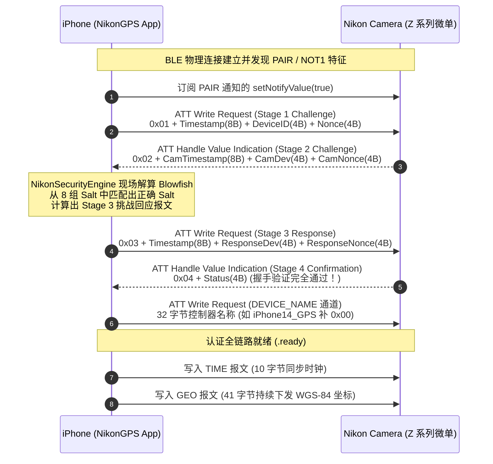

# 📸 NikonGPS for iOS · AI Agent 核心上下文与知识库规约 (AGENT.md)

本文档作为 AI Agent 在 `ios/` 目录进行后续开发、功能演进、Bug 修复及性能优化的 **核心持久化记忆与技术知识库（Single Source
of Truth）**。后续所有代理均必须在进入任务前阅读并严格遵循本文档所总结的技术规范与工程约束。

---

## 1. 核心定位与业务价值

- **项目定位**：专为 **iOS 平台（iPhone / iPad）** 深度定制的尼康微单/单反相机轻量化、纯 BLE (Bluetooth Low Energy) GPS
  与时钟持续同步中枢；
- **解决的痛点**：
    1. **彻底摆脱 SnapBridge 臃肿与杀后台**：官方 App 强行绑定照片无线传输与 Wi-Fi 切换，内存占用高、发热严重、锁屏极易被
       iOS 系统杀后台；
    2. **突破单相机限制（多机位并发同步）**：官方 App 限制单设备连接；本项目底层采用多会话并发架构，单台 iPhone 获取的高精
       GPS 坐标可 **同时分发注入双持或多台尼康相机**；
    3. **纯 BLE 免配对直连**：基于已提取的真机合法凭据（`DeviceID` + `Nonce`），相机开机即瞬间连通，彻底杜绝跳出系统蓝牙设置的繁琐步骤。

---

## 2. 业界逆向成果对比与技术吸收 (Prior Art & Comparative Analysis)

本项目站在多个开源逆向成果与实战探索的肩膀上，并克服了跨平台（特别是 iOS 严格沙盒与安全体系）的底层差异：

| 维度              | 天空 Blond 逆向先驱 (skyblond.info) | hurui200320/nsg (ESP32/Python)   | Android 逆向生态 (nikon-ble)      | **本项目 (NikonGPS for iOS)**                      |
|:------------------|:------------------------------------|:---------------------------------|:----------------------------------|:---------------------------------------------------|
| **运行平台**      | 协议分析 / PC 抓包                  | 嵌入式硬件 (ESP32) / 桌面 Python | Android 手机                      | **iOS (iPhone/iPad 原生)**                         |
| **配对机制**      | 分析了 BLE 广播基本属性             | 实现了 17 字节 Blowfish 握手过程 | 利用 Java PRNG 种子缺陷反推 Nonce | **PacketLogger 抓包反填 + 纯 BLE 快速认证**        |
| **经典蓝牙依赖**  | 探讨了经典蓝牙配对的假设            | 需要蓝牙物理硬件特定配置         | 视机型而定                        | **彻底移除经典蓝牙，100% 纯 BLE 链路**             |
| **时钟/GPS 协议** | 初步解析特征通道                    | 完整提取 10B `TIME` 与 41B `GEO` | 基本实现                          | **严格遵循“先时间后坐标”与防 0x80 错误纪律**       |
| **系统级保活**    | 无                                  | 硬件长供电常开                   | Android 无限制后台 Service        | **CoreBluetooth State Restoration + 高精定位守护** |

### 关键破局教训与真相（严禁走弯路）：

1. **iOS 无法使用 Android 的随机数推算漏洞**：
    - Android 平台的 SnapBridge 采用 Java `java.util.Random` 生成 Nonce，其 48 位线性同余生成器（LCG）存在数学缺陷，可从广播中的
      4 字节数据爆破出 PRNG 内部种子从而预测出 Nonce；
    - **但在 iOS 平台**，SnapBridge 调用的是 iOS 系统密码级强随机数 `SecRandomCopyBytes`，不存在任何算法反推可能性。
2. **尼康 Expeed 7 时代现代微单配对机制真相**：
    - Z6 III、Z8、Z9、Z50 II、Zf 等现代微单在配对向导中 **根本没有广播传统经典蓝牙（BR/EDR）**，macOS 的
      `IOBluetoothDeviceInquiry` 与 iOS 系统设置在附近设备中永远搜索不到；
    - 官方 SnapBridge 能够走通，是因为它拥有苹果 MFi 认证，走的是系统级 **BLE LE Secure Connections (LESC) Numeric
      Comparison** 触发系统级配对弹窗；普通第三方 App 无法调用私有 MFi 配对通道。
3. **PacketLogger 抓包反填是 100% 确定性的终极胜利路径**：
    - 相机 NVRAM 机制真相： **只要 iPhone 曾通过官方 SnapBridge 与相机成功连接过一次，相机机身固件中就已经永久记录了该
      iPhone 的合法凭据（4 字节 DeviceID 与 4 字节 Nonce）**；
    - 相机日常开机重连时， **只校验传入的 DeviceID 和 Nonce 是否与 NVRAM 中匹配，完全不认物理 App 实例**；
    - 因此，只需抓包一次提取出这对密钥，本项目即可在不经过配对菜单的情况下，以合法控制器身份与相机完成纯 BLE 秒连！

---

## 3. 尼康相机 BLE 通信协议技术规范 (Protocol Specifications)

### 3.1 GATT 服务与特征通道 UUID 矩阵

尼康智能设备专用服务基础 UUID：`0000xxxx-0000-0000-0000-00004e494b4f`（ASCII 尾部为 `NIKON`）。

| 特征名称        | UUID 标识符                            | 属性 (Properties)       | 长度 / 格式   | 功能职责                                     |
|:----------------|:---------------------------------------|:------------------------|:--------------|:---------------------------------------------|
| **Service**     | `00000000-0000-0000-0000-00004e494b4f` | -                       | -             | 尼康智能设备核心服务                         |
| **PAIR**        | `00000001-0000-0000-0000-00004e494b4f` | Write, Notify, Indicate | 17 字节       | 核心四阶段认证挑战通道                       |
| **NOT1**        | `00000002-0000-0000-0000-00004e494b4f` | Notify, Indicate        | 变长          | 状态与事件通知通道                           |
| **DEVICE_NAME** | `00000003-0000-0000-0000-00004e494b4f` | Write, Read             | 32 字节 ASCII | 智能设备控制器注册名称 (如 `iPhone14_GPS\0`) |
| **TIME**        | `00000004-0000-0000-0000-00004e494b4f` | Write                   | 10 字节       | 相机时钟与时区同步报文                       |
| **GEO**         | `00000005-0000-0000-0000-00004e494b4f` | Write                   | 41 字节       | WGS-84 地理位置与海拔注入报文                |

---

### 3.2 四阶段认证挑战流转 (Four-Stage Handshake)



1. **报文统一内存布局 (17 字节小端序)**：
    - Byte 0: `stage`（`0x01` / `0x02` / `0x03` / `0x04`）；
    - Byte 1..8: `timestamp`（64 位无符号时间戳）；
    - Byte 9..12: `device`（32 位无符号整数）；
    - Byte 13..16: `nonce`（32 位无符号整数）；
2. **Blowfish 加密引擎与 8 组 Salt 碰撞**：
    - 固定密钥：`0xFF, 0xFF, 0xAA, 0x55, 0x11, 0x22, 0x33, 0x00`；
    - 算法模式：标准 Blowfish ECB 模式，无填充；
    - 8 组预置 Salt 常量：
      ```text
      Salt 0: [0x704066e4, 0x0433d552]    Salt 4: [0xfda588c1, 0xeba8b1f3]
      Salt 1: [0xed4b8fac, 0x15f7e47b]    Salt 5: [0x99166056, 0x1bd3d550]
      Salt 2: [0x24471f11, 0x8b5ea1fc]    Salt 6: [0xcd32687f, 0xa9e28a30]
      Salt 3: [0x05960c31, 0x2b8c7f41]    Salt 7: [0x2a8fe834, 0xdec7ebf4]
      ```
    - 匹配规则：以 `[salt[0], salt[1], camTsLo, camTsHi, ourTsLo, ourTsHi]` 作为输入块逐次加密，当哈希结果的
      `(left, right)` 逐字节等于相机在 Stage 2 下发的挑战值时，锁定该组 Salt，并以此计算 Stage 3。

---

### 3.3 时钟与地理报文防拒写铁律 (Crucial Discipline)

1. **时钟基准与重连极速原则**：
    - 首轮物理连通或系统时区变更（`NSSystemTimeZoneDidChange`）时，系统下发一次 `TimePayload`（10 字节），校准相机内部 RTC
      时钟与时区；
    - 随后的快门唤醒重连中，相机已有时间基准，允许跳过重复校时以实现毫秒级快速恢复（真机 `test4` 实测证实无需重复写 TIME）；
2. **10 字节 `TIME` 报文结构**：
    - Byte 0..1: 年份（小端序 UInt16，如 2026）；
    - Byte 2: 月（1~12）；Byte 3: 日（1~31）；Byte 4: 时（0 ~23）；Byte 5: 分（0~59）；Byte 6: 秒（0~59）；
    - Byte 7: 符号（`0x00` 表示正时区，`0x01` 表示负时区）；
    - Byte 8: 时区偏移小时数；Byte 9: 夏令时标记（`0x01` / `0x00`）；
3. **41 字节 `GEO` 报文结构与防 0x80 ATT 错误机制**：
    - 格式包含度、分、万分之一分（百分位）、南北纬/东西经标识、海拔数值与符号；
    - 尾部必须携带 `0x01` (有效 Fix 标记) 及 ASCII 编码的 `"WGS-84"` 标识（补 10 字节 `0x00` 填充）；
    - **时间戳新鲜度绝对防御 (Stale Fix Defense) ✨**：
        - 若向相机写入的 GPS 报文时间戳与当前时刻滞后严重（如未开巡航时使用数小时前的旧定位缓存，`test8` 实测滞后 2.5
          小时），相机固件内部校验判定为过期无效卫星数据， **会在 ATT 应用层返回 `0x80` 拒写**；
        - 解决方案：`GeoPayload` 自动自愈对齐当前时刻 `Date()`，`LocationProvider` 在坐标陈旧（>60s）时执行单次高精度定位补位（
          `requestSingleFreshLocation`），严禁下发陈旧数据；
    - **GPS 信号丢失保护**：当手机进入室内或隧道丢失卫星 Fix 时， **严禁向相机下发全空或未修正的异常报文**；此时仅下发一次
      `isValid = false` 的报文，并停止下发，等待卫星重新 Fix。
4. **设备匹配三阶严格算法规约 (Tiered Device Matching) ✨**：
    - 彻底废除 `contains` 模糊比对，彻底杜绝 `NSTaggedPointerString` 快速枚举崩溃与多机串机；
    - 统一收口至 `CameraDevice.matches(...)`：
        - 第一阶：`discoveredDeviceID` 硬件 4 字节绝对匹配；
        - 第二阶：`bleIdentifier` 本地固化 UUID 不区分大小写匹配；
        - 第三阶：`CameraDevice.canonicalName` 严格相等 `==`（去除品牌前缀、大小写与内部空格差异，防占位符）。

---

## 4. iOS 系统端工程实现架构

```
ios/
├── Package.swift                             // SPM 依赖与资源配置 (声明 camera_credentials.json)
├── App/
│   ├── NikonGPSAppMain.swift                 // SwiftUI App 入口
│   └── Info.plist                            // 后台模式 (bluetooth-central, location) 与隐私说明
├── Sources/NikonGPSCore/                     // 核心业务框架
│   ├── Resources/
│   │   ├── camera_credentials.example.json   // 开源占位/参考模板 (提交至 Git)
│   │   └── camera_credentials.json           // 本地私有真机凭据存储 (由 extract_pklg_credentials.py 生成，已加入 .gitignore 防泄露)
│   ├── Crypto/
│   │   ├── Blowfish.swift                    // 基于 Apple CommonCrypto 的原生 Blowfish 实现
│   │   └── NikonSecurityEngine.swift         // 8 组 Salt 碰撞校验与 Stage 3 挑战生成
│   ├── Protocol/
│   │   ├── NikonUUIDs.swift                  // 尼康 BLE UUID 矩阵
│   │   ├── PairingMessage.swift              // 17 字节握手报文编解码
│   │   ├── TimePayload.swift                 // 10 字节时间报文
│   │   └── GeoPayload.swift                  // 41 字节 WGS-84 坐标报文
│   ├── Models/
│   │   ├── CameraDevice.swift                // 相机实体与连接状态
│   │   ├── SyncStats.swift                   // 统计与位置快照
│   │   └── GPXTrackModels.swift              // 轨迹点 (GPXRecordedPoint) 与会话摘要 (GPXTrackSession)
│   ├── Services/
│   │   ├── CameraConfigLoader.swift          // 凭据配置装载器 (Bundle.module / main / 源码探测)
│   │   ├── NikonBluetoothManager.swift       // CoreBluetooth 纯 BLE 状态机与多路分发
│   │   ├── LocationProvider.swift            // CoreLocation 后台定位与自适应防抖节电
│   │   ├── CameraSyncCoordinator.swift       // 业务协同与 SwiftUI 状态绑定中枢
│   │   ├── GPXExporter.swift                 // 符合 GPX 1.1 规范的合法 XML 序列化器
│   │   └── GPXRecorderService.swift          // 巡航轨迹持续录制、自适应去噪与断电容灾自愈服务
│   └── Views/
│       ├── MainDashboardView.swift           // 主仪表盘 (巡航控制、实时坐标、设备卡片、日志流)
│       ├── PairingGuideView.swift            // 纯 BLE 直连向导
│       ├── GPXTrackHistoryView.swift         // 巡航轨迹档案历史列表与系统分享视图
│       ├── ShareSheet.swift                  // 原生系统分享浮层包装组件 (UIActivityViewController)
│       └── NikonGPSMainAppView.swift         // 顶层导航视图
├── tools/
│   ├── extract_pklg_credentials.py           // 0 依赖 PacketLogger 抓包解析与闭环验真工具
│   ├── HOW_TO_CAPTURE_PKLG_ON_IPHONE.md      // iPhone 蓝牙数据包抓取保姆级实战教程
│   └── captures/                             // 离线真实机型抓包样本库 (*.pklg)
└── Tests/NikonGPSCoreTests/                  // 自动化单元测试 (28/28 全部绿灯闭环)
    ├── BlowfishTests.swift
    ├── HandshakeTests.swift                  // 真实抓包向量 100% 逐字节断言
    ├── CameraConfigLoaderTests.swift         // 配置文件加载与十六进制解析测试
    ├── TimePayloadTests.swift
    ├── GeoPayloadTests.swift
    ├── PairingMessageTests.swift
    ├── GPXExporterTests.swift                 // GPX 1.1 XML 规范合法性、ISO8601 UTC 时间与 Haversine 算力测试
    └── GPXRecorderTests.swift                // 巡航录制生命周期、精度过滤、防漂移与文件落盘测试
```

### 4.1 配置文件驱动体系 (`CameraConfigLoader`)

- **配置分离**：业务代码中绝不硬编码任何相机的 `DeviceID` 与 `Nonce`；
- **配置格式**：
  ```json
  {
    "cameras": [
      {
        "name": "Nikon Z6_3_1234567",
        "deviceID": "0x12345678",
        "nonce": "0x87654321",
        "controllerName": "iPhone_NikonGPS",
        "isDefault": true,
        "comment": "自动从 extract_pklg_credentials.pklg 提取，100% 闭环验真通过"
      }
    ]
  }
  ```
- **多环境容错加载机制**：
    1. SPM 打包模式：`Bundle.module.url(forResource: "camera_credentials", withExtension: "json")`
    2. 主应用打包模式：`Bundle.main.url(forResource: "camera_credentials", withExtension: "json")`
    3. 源码开发与测试模式：探测本地文件系统工程目录。

### 4.2 后台保活与自适应节电策略

1. **CoreBluetooth State Restoration**：
    - 实例化 `CBCentralManager` 时注入 `CBCentralManagerOptionRestoreIdentifierKey`；
    - 注册 `centralManager(_:willRestoreState:)` 恢复外设引用，在 App 被挂起时由系统代管事件唤醒；
2. **CoreLocation 节电防抖策略**：
    - 开启 `allowsBackgroundLocationUpdates = true`，拥有「始终」定位权限后消除灵动岛/状态栏大蓝条；
    - **硬件级物理滤波**：设置 `locationManager.distanceFilter = 3.0`，从 iOS 基带源头抑制电离层静止微漂移；
    - **软件级自适应防抖**：当摄影师处于原地休整、未发生物理位移（位移 < 5 米）且时间未超过 25 秒时，跳过下发；位移超过 5
      米或超时，即时触发最新经纬度注入。

### 4.3 待机休眠与快门唤醒秒连架构 (Standby Timer & Instant Wake Injection)

1. **CoreBluetooth 系统内核级挂起重连 (Pending Connection)**：
    - 针对尼康相机开启「待机定时器 (Standby Timer)」熄屏后主动切断物理链路（原因码 7:
      `The specified device has disconnected from us`）的场景；
    - 断开后 **不销毁 Session 实例**，保留内存中已有的 GATT 特征句柄缓存；
    - 立即调用 `centralManager.connect(peripheral, options: ...)` 挂入 iOS 系统内核。苹果机制规定挂起连接无超时限制，在底层硬件基带中以微安级微弱功耗无感待命；
2. **GATT 特征缓存直通 (GATT Cache Pass-Through)**：
    - 摄影师半按快门唤醒相机瞬间，相机恢复广播，iOS 硬件基带在 10~20ms 内瞬间秒连 (`didConnect`)；
    - `resumeOrStart()` 命中内存中的特征句柄缓存， **彻底跳过耗时的空中服务与特征检索（`discoverServices` /
      `discoverCharacteristics`）**，空中往返时间从 ~400ms 降至 0ms；
3. **开机首轮会话校时与待机快门唤醒精准解耦 (`hasCompletedBootSync`)** ✨：
    - 尼康机身安全机制要求每次物理链路重建必须跑 Stage 1~3 轻量会话刷卡以开放写入权限；
    - **首轮开机会话**（`hasCompletedBootSync == false`）：无论是首次配对还是免配对凭据冷启动直连，握手就绪后强制执行一次
      `ensureTimeSynchronized(force: true)`，完成机身时区与时钟对齐，随后置位 `hasCompletedBootSync = true`；
    - **待机休眠与快门唤醒**（`hasCompletedBootSync == true`）：进入待机熄屏（0x1D）到半按快门唤醒（0x1C）仅为链路恢复，绝对不算开机！系统
      **严格跳过 TIME 报文写入**，彻底废除 30 分钟无脑轮询补偿机制，日常 GPS 下发绝对不碰 `writeTime`；
    - **纯事件驱动时区补偿 (`NSSystemTimeZoneDidChange`)** ✨：仅在 iOS 系统监听到系统时区真实变更通知时，才主动向就绪相机下发时区补偿，并重置休眠相机会话标志位；
    - **进程杀死与退出兜底清理 (`handleProcessTermination`)**：标志位作为纯内存会话管理；监听
      `UIApplication.willTerminateNotification` 触发安全兜底，重置所有相机标志位、封包保存正在录制的 GPX 轨迹并彻底停用传感器。
4. **唤醒即刻主动补发最新 GPS (Instant GPS Injection On Wake)**：
    - 会话进入 `.ready` 状态的第一时间，Coordinator 主动提取 `LocationProvider.latestValidLocation` 并立即推入相机 EXIF；
    - 确保摄影师在原地休整唤醒相机按下的第一张照片 100% 具备精确机位经纬度。
5. **蓝牙连接策略最佳实践 (方案 C：前台轻感知 + 后台巡航守护)** ✨：
    - **延续巡航记忆**：外拍期间摄影师通常保持巡航开启；若上次退出时处于“巡航中”，冷启动后自动恢复巡航（高精定位 +
      蓝牙后台秒连），实现真正的“掏机即拍、零触碰”；
    - **前台轻量发现**：若当前未开启巡航，当 App 处于前台活跃状态（`scenePhase == .active`
      ）时，自动启动低功耗蓝牙扫描，捕获相机并秒级连接对齐时钟，卡片亮起绿色就绪徽章；
    - **后台严格受控**：未开启巡航时，一旦 App 退到后台或锁屏（`scenePhase == .background`），立即停止蓝牙扫描，达到 0
      功耗，绝不在后台骚扰相机或抢占电脑传图信道。

---

## 5. 后续开发核心红线与纪律 (Agent Commandments)

任何后续参与本项目的 AI Agent 必须无条件遵守以下铁律：

1. **绝对严禁重新引入经典蓝牙代码 (No Classic Bluetooth)**：
    - 尼康现代相机在智能连接体系中不广播传统经典蓝牙；严禁引入 `IOBluetooth`、经典蓝牙 SSP 扫描、或引导用户跳转系统蓝牙设置等待
      6 位比对码的逻辑；
2. **严禁硬编码密钥与敏感凭据 (No Hardcoded Credentials & Privacy Leakage) 🛡️**：
    - **绝对红线**：严禁在代码、测试、注释或文档中散落或硬编码用户个人的真实相机机身序列号、真实配对凭据（DeviceID /
      Nonce）、蓝牙物理 MAC 地址或个人控制器设备名；
    - **配置隔离**：真实真机凭据必须完全外部化隔离在 `camera_credentials.json` 中，由 `.gitignore` 保护；代码库仅公开脱敏后的示例模板
      `camera_credentials.example.json`；
    - **抓包文件隔离**：所有 `.pklg` 蓝牙二进制抓包由 `.gitignore` 全局拦截，严禁提交任何真实抓包文件；
    - **代码与测试使用通用 Mock 占位**：一律使用 `Z6_3_1234567`、`0x12345678`、`0x87654321`、`iPhone_NikonGPS` 等安全占位；
    - **UI 与日志脱敏过滤**：所有界面卡片展示和控制台输出的机身序列号必须经由 `CameraDevice.maskText` / `maskName` /
      `maskSerialNumber` 自动打码脱敏；
3. **保持 0 依赖纯净性 (Zero External Dependencies)**：
    - 加密算法严格基于 macOS / iOS 原生 `CommonCrypto`；
    - 抓包提取工具 `extract_pklg_credentials.py` 严格基于原生 Python 标准库与 `ctypes` 调用系统 `libcommonCrypto.dylib`
      ，禁止引入第三方 pip 依赖；
4. **单元测试 100% 闭环要求**：
    - 任何涉及协议解析、加密运算、配置加载或状态机变更的代码，必须在 `Tests/PhotoolsMobileCoreTests/` 中维护对应的单元测试，且
      `swift test --package-path apps/ios/PhotoolsMobile`（BypassSandbox: true）必须秒级通过；
5. **思维与交互语言**：
    - 思维推理过程（Thinking Process）及所有输出 **统一强制使用简体中文**。
