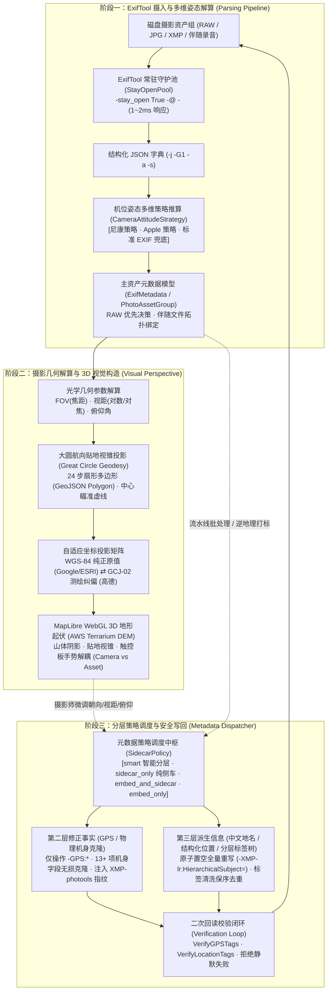
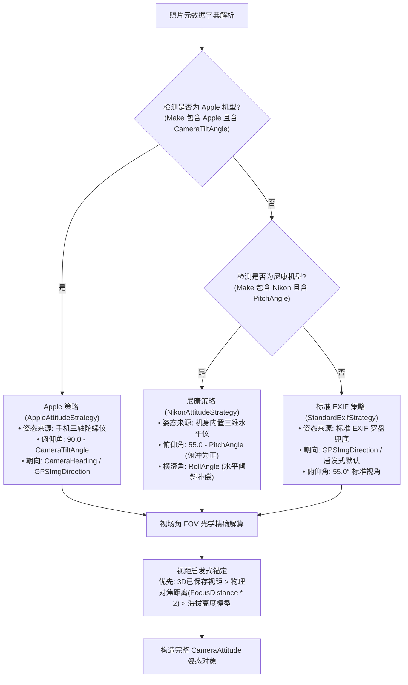
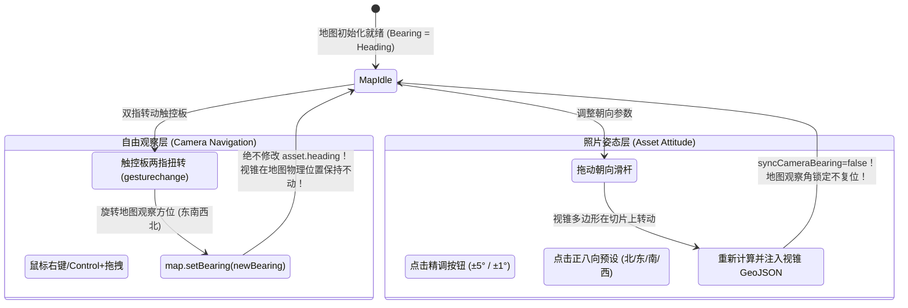
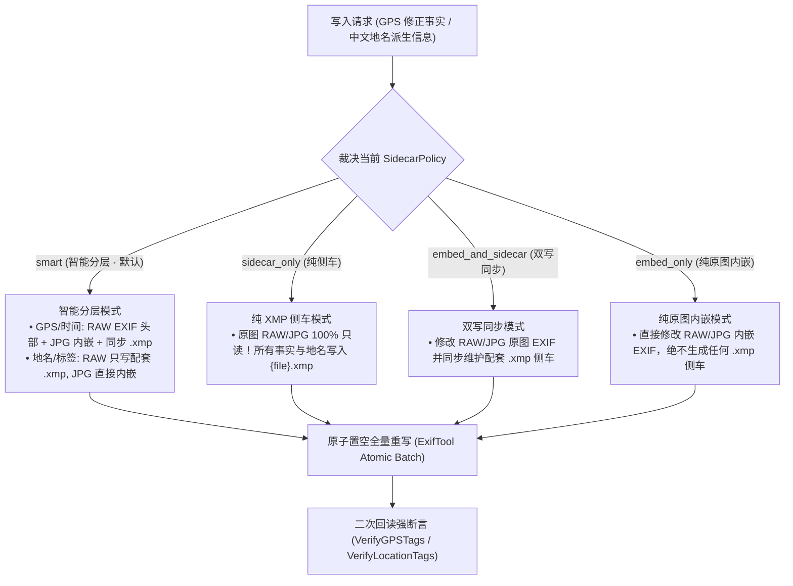
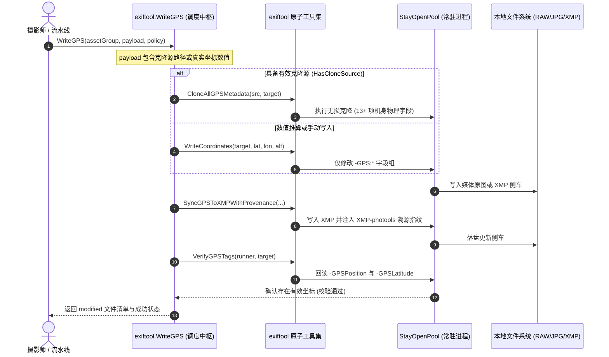
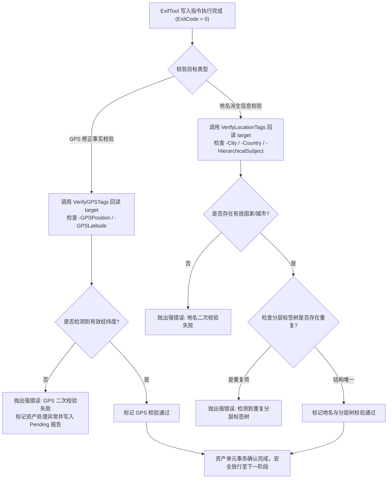

# 📷 ExifTool 数据解析、视觉三维构造与元数据分层写回全流程技术规范 (EXIF_VISUAL_PIPELINE_END_TO_END_SPEC.md)

本文档详细阐述 `photools` 系统中**摄影元数据从底层提取（ExifTool Ingestion）到几何建模与三维视觉呈现（Visual Perspective
Construction），再到策略分层安全写回（Metadata Dispatcher & Safe Writing）**的全链路技术实现、数学公式与流程时序图。

---

## 1. 全景数据流转架构 (End-to-End Architecture)

整个摄影资产从磁盘读取到界面渲染，再到元数据安全写回的生命周期严格遵循**
“下层纯净原子函数、中层统一策略调度、上层全链路复用”**的架构铁律：



---

## 2. 阶段一：ExifTool 深度解析与多维姿态摄入流 (Parsing Pipeline)

### 2.1 底层常驻守护进程驱动 (`StayOpenPool`)

传统 CLI 每次调用 `exec("exiftool ...")` 存在高达 $30\text{ms} \sim 50\text{ms}$ 的进程创建与 Perl 解释器冷启动损耗。
生产环境强制使用 `exiftool.DefaultRunner`（基于 `-stay_open True -@ -` 的常驻守护进程池）：

- **管道交互**：通过向标准输入逐行发送参数数组并附加 `-execute\n`，实现微秒级会话复用；
- **响应速度**：单次解析耗时骤降至 $1\text{ms} \sim 2\text{ms}$；
- **自愈机制**：进程发生崩溃或意外 Broken Pipe 时，连接池自动回收并重连重建守护进程。

### 2.2 基础光学参数与姿态提取指令

解析指令核心参数集：

```bash
exiftool -m -q -j -G1 -a -s -c "%.6f" -d "%Y-%m-%d %H:%M:%S" <FilePath> [<SidecarPath>]
```

提取的多维字段字典映射矩阵：

| 领域分类             | 目标 EXIF / MakerNotes 原始标签                          | 解析字段与业务模型映射                          | 算法与业务含义                        |
|:---------------------|:---------------------------------------------------------|:------------------------------------------------|:--------------------------------------|
| **基础曝光**         | `Make`, `Model`, `LensModel`                             | `cameraMake`, `cameraModel`, `lensModel`        | 相机与镜头硬件标识                    |
| **曝光四要素**       | `FNumber`, `ExposureTime`, `ISO`, `FocalLength`          | `fNumber`, `exposureTime`, `iso`, `focalLength` | 光圈值、快门时间、感光度、物理焦距    |
| **等效视场**         | `FocalLengthIn35mmFormat`                                | `focalLength35mm`, `fieldOfView`                | 35mm 等效焦距，用于精确计算视场角 FOV |
| **机身姿态 (Apple)** | `MakerNotes:CameraTiltAngle`, `MakerNotes:CameraHeading` | `pitchAngle`, `gpsImgDirection`                 | 陀螺仪捕获的绝对俯仰角与真北偏航角    |
| **机身姿态 (Nikon)** | `Nikon:PitchAngle`, `Nikon:RollAngle`, `Nikon:Heading`   | `pitchAngle`, `rollAngle`, `gpsImgDirection`    | 尼康微单机身水平仪与电子罗盘数据      |
| **光学对焦距离**     | `MakerNotes:FocusDistance`, `Composite:FocusDistance`    | `focusDistanceMeters`                           | 镜头物距，3D 视锥距离智能锚定首选源   |
| **时空 GPS 事实**    | `GPSLatitude`, `GPSLongitude`, `GPSAltitude`             | `latitude`, `longitude`, `altitude`             | 原始标准 WGS-84 经纬度与海拔          |
| **分层标签树**       | `XMP-lr:HierarchicalSubject`, `IPTC:Keywords`            | `hierarchicalSubject`, `keywords`               | 摄影师业务标签树与地名层级关键词      |
| **结构化位置**       | `XMP-iptcExt:LocationCreated`, `XMP-photoshop:*`         | `locationCreated`, `city`, `province`           | IPTC Extension 结构化地理信息         |

### 2.3 机位姿态多维策略推算引擎 (`CameraAttitudeStrategy`)

系统根据机身品牌和元数据完备度，自动匹配最优姿态解算策略（位于 `PhotoolsCore/Services/CameraAttitude/`）：



### 2.4 主资产模型与 RAW 伴随姿态穿透 (Primary Asset Model)

- **主文件优先**：在 `RAW + JPG` 双格式并存时，系统以 RAW 为核心真值决策源；
- **同组伴随无损穿透**：当检查器解析单独的伴随 JPG 时，若发现 JPG 缺失尼康机身私有姿态（`PitchAngle`、`FocusDistance`
  被相机内部压制剥离），系统自动向同名伴随 RAW 发起微秒级穿透探测， **提取 RAW 机身私有水平仪与对焦参数反哺 JPG 呈现**
  ，实现无缝视觉统一。

---

## 3. 阶段二：摄影几何解算与 3D 视觉构造 (Visual Perspective Construction)

### 3.1 光学视场角 (FOV) 计算数学模型

视场角（Field of View）由 35mm 全画幅胶片宽度（标准 $36\text{mm}$）与等效焦距 $f_{35}$ 严格推导：
$$\text{FOV} = 2 \times \arctan\left (\frac{36\text{mm}}{2 \times f_{35}}\right) \times \frac{180^\circ}{\pi}$$

- $24\text{mm}$ 超广角：$\text{FOV} \approx 84.1^\circ$；
- $35\text{mm}$ 人文镜头：$\text{FOV} \approx 63.4^\circ$；
- $50\text{mm}$ 标准镜头：$\text{FOV} \approx 46.8^\circ$；
- $200\text{mm}$ 远摄长焦：$\text{FOV} \approx 12.3^\circ$。

### 3.2 大圆航向贴地视锥投影算法 (Great Circle Forward Geodesy)

视锥在三维地球上并非平面的三角形，而是遵循地球曲率的 **球面扇形贴地多边形（GeoJSON Polygon）**：

1. **机位顶点**：起始坐标 $P_0 = (\text{Lng}_0, \text{Lat}_0)$；
2. **中心瞄准点**：自 $P_0$ 沿拍摄朝向 $\theta$ 向前投影距离 $D$，经球面测地公式推算目标经纬度 $P_{\text{aim}}$；
3. **扇形弧边界**：从 $\theta - \frac{\text{FOV}}{2}$ 到 $\theta + \frac{\text{FOV}}{2}$ 细分为 24 个离散步进角 $\phi_i$：
   $$\sin (\text{Lat}_i) = \sin (\text{Lat}_0)\cos\delta + \cos (\text{Lat}_0)\sin\delta\cos\phi_i$$
   $$\text{Lng}_i = \text{Lng}_0 + \arctan2\left (\sin\phi_i\sin\delta\cos (\text{Lat}_0), \cos\delta - \sin (\text{Lat}_0)\sin (\text{Lat}_i)\right)$$
   其中 $\delta = \frac{D}{R_{\text{earth}}}$ 为角距离。
4. **闭合闭环**：以序列 $[P_0, P_{\text{arc}_0}, P_{\text{arc}_1}, \dots, P_{\text{arc}_{24}}, P_0]$ 输出为标准的 GeoJSON
   Feature 并注入 MapLibre。

### 3.3 AWS Terrarium DEM 高程解码与 3D WebGL 地形渲染

系统采用全球高精 AWS Terrarium DEM 切片，通过 MapLibre 的 WebGL Fragment Shader 在 GPU 中实时解码真实海拔：
$$\text{Elevation (Meters)} = \left (R \times 256 + G + \frac{B}{256}\right) - 32768$$

- GPU 实时将二维卫星影像与视锥多边形拉伸贴合在数字高程网格表面；
- 叠加 `hillshade` 动态山体阴影（夸张系数 $1.30\times$），呈现峡谷深浅与山脊层次。

### 3.4 坐标系投影转换与原图零污染矩阵

```
真实物理机位 (WGS-84) ──┬─► Google 卫星 / ESRI 遥感 (WGS-84) ──► 0 偏移物理直投 (真实建筑物精确贴合)
                        │
                        └─► 高德遥感卫星 (GCJ-02) ────────────► CoordinateConverter.wgs84ToGCJ02() (东南纠偏 630m 贴合切片)
```

- **绝对零污染原则**：照片原图 EXIF/XMP 文件内部永远只记录真实的 WGS-84 国际物理坐标，坐标偏转仅发生在 WebGL 渲染管线内存中。

### 3.5 触控板自由手势与摄影参数解耦状态机

为了让摄影师自由漫游地图而不破坏照片拍摄朝向，系统在交互层实现了 **双层解耦状态机**：



---

## 4. 阶段三：元数据分层写回与安全调度器 (Metadata Dispatcher)

### 4.1 四档写入策略与物理写入矩阵 (`SidecarPolicy`)

全库所有写入必须统一步调调用中层调度器 `exiftool.WriteGPS` 与 `exiftool.WriteLocation`：



### 4.2 第二层修正事实调度时序 (GPS 写入与克隆)

当摄影师匹配 GPX 轨迹、GPS 时间插值推算或在 3D 界面微调姿态并点击保存时，触发第二层事实写入：



### 4.3 第三层派生信息调度 (中文地名与分层标签树)

在逆地理阶段或编辑地名时，调度器严格遵守 **防污染与幂等性铁律**：

- **绝对置空重写**：严禁使用破坏幂等性的 `+=` 追加，指令内强制先原子置空旧标签：
  ```bash
  exiftool -m -overwrite_original \
    -XMP-lr:HierarchicalSubject= \
    -XMP-lr:HierarchicalSubject="地点|中国|广东省|广州市|天河区" \
    -XMP-lr:HierarchicalSubject="题材|人像" \
    <TargetFile>
  ```
- **标签清洗与题材保护 (`CleanAndMergeLocationTags`)**： 在写入前，系统通过算法自动剔除旧的地理前缀树（如 `中国|*`、
  `China|*`），同时 **100% 完整保留摄影师自定义的业务题材关键词**（如 `题材|人像`、`活动|婚礼`、`扫街` 等），并使用保序 Set
  机制剔除重复项；
- **防历史缝合怪**：当机位缺失区县或景区 POI 时，调度器显式写入置空指令，彻底杜绝跨机位微调时拼接残留旧地名。

---

## 5. 阶段四：二次回读校验与容错闭环 (Safety Verification Loop)

写入成功判定 **绝不能仅依赖 ExifTool 进程的退出码 0**，必须包含完整的二次回读强断言：



---

## 6. 核心实现源码对应索引表

| 核心领域模块      | 负责文件路径                                      | 核心函数 / 结构体符号                        | 职责与设计模式                          |
|:------------------|:--------------------------------------------------|:---------------------------------------------|:----------------------------------------|
| **常驻进程驱动**  | `internal/exiftool/pool.go`                       | `StayOpenPool`, `DefaultRunner`              | 常驻 `-stay_open` 进程池与崩溃自愈      |
| **底层原子写入**  | `internal/exiftool/exiftool.go`                   | `WriteCoordinates`, `CloneAllGPSMetadata`    | 纯净原子基元，仅操作特定标签            |
| **策略调度中枢**  | `internal/exiftool/dispatcher.go`                 | `WriteGPS`, `WriteLocation`, `Verify*`       | 统领四大策略模式分发与二次回读断言      |
| **标签清洗合并**  | `internal/domain/location.go`                     | `CleanAndMergeLocationTags`                  | 剥离旧地名树，100% 保护摄影师自定义标签 |
| **EXIF 异步解析** | `PhotoolsCore/.../ExifMetadataReader.swift`       | `readMetadata`, `enrichWithCompanionRAW`     | 跨语言 FFI 优先微秒直通与 RAW 伴随穿透  |
| **机位姿态策略**  | `PhotoolsCore/.../CameraAttitude/`                | `CameraAttitudeStrategy`, `Nikon*`, `Apple*` | 尼康微单/Apple/标准EXIF三维姿态多维推算 |
| **坐标投影中枢**  | `PhotoolsCore/.../CoordinateConverter.swift`      | `wgs84ToGCJ02`, `isOutOfChina`               | 测绘法规坐标加密形变与自适应纠偏        |
| **图源数据模型**  | `PhotoolsCore/.../MapTileProvider.swift`          | `MapTileProvider`, `renderCoordinate`        | 四大免 Key 图源切片池与坐标系自适应映射 |
| **3D WebGL 视图** | `PhotoolsApp/.../PhotoPerspective3DMapView.swift` | `PhotoPerspective3DMapView`, `Coordinator`   | MapLibre WebGL 真实高程地形与视锥渲染   |
| **摄影控制台**    | `PhotoolsApp/.../PhotoPerspectiveSheet.swift`     | `PhotoPerspectiveSheet`, `adjust*`           | 触控板手势解耦、视距/俯仰自适应精调交互 |
