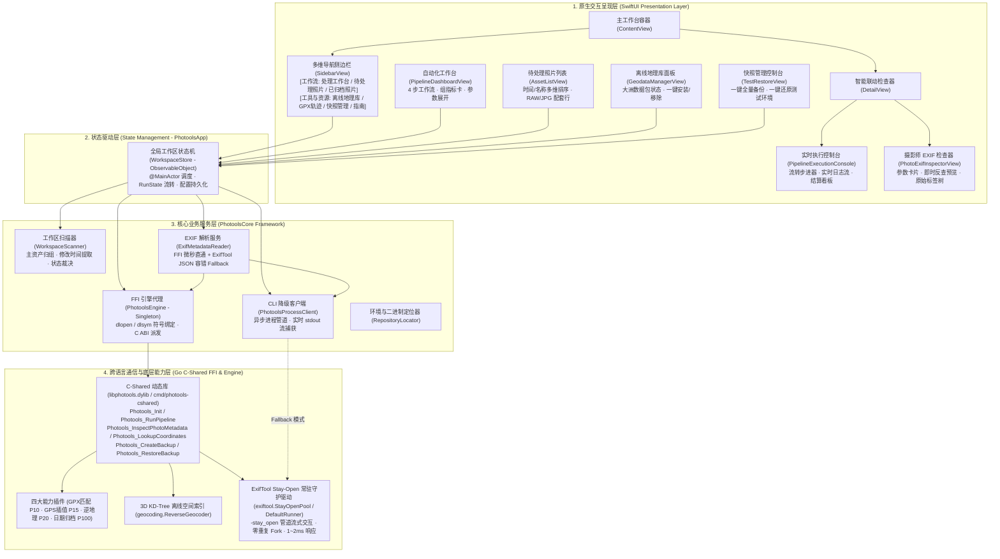
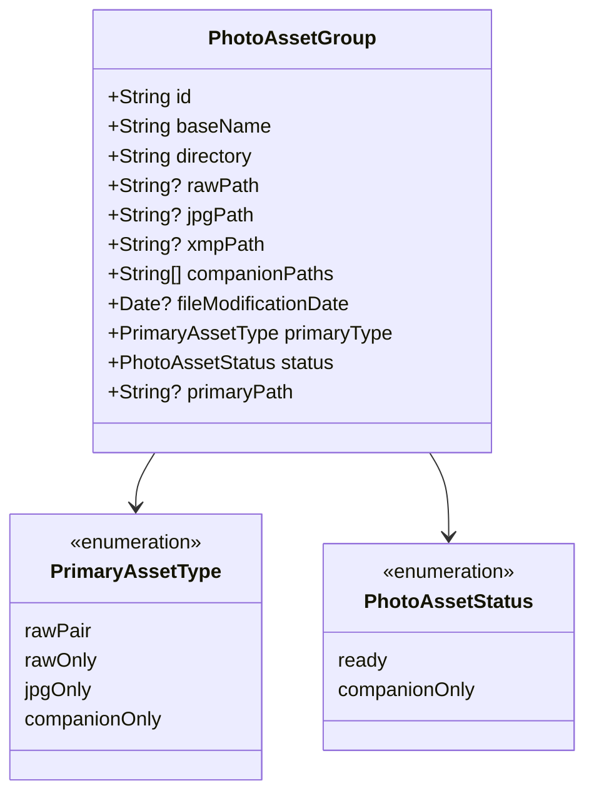
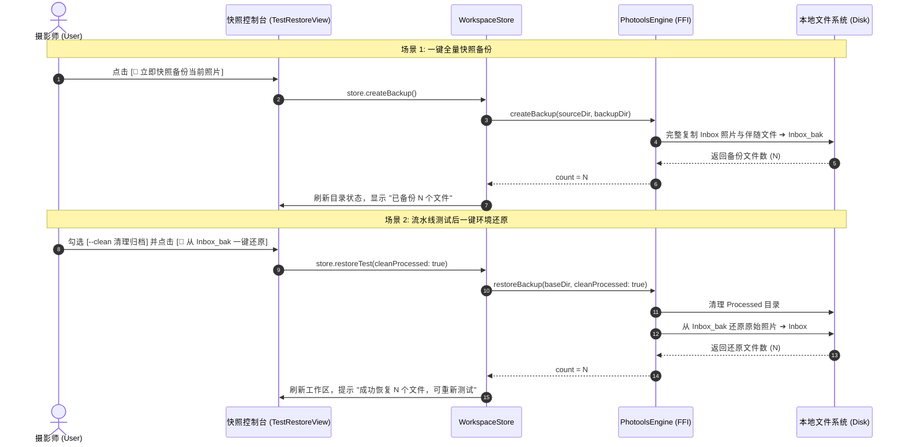

# 🍏 photools macOS 原生客户端架构与技术设计文档 (MACOS_CLIENT_TECHNICAL_DESIGN.md)

本文档详细记录 `photools` macOS 原生客户端（`apps/macos/PhotoolsApp`）的总体系统架构、UI/UX 交互设计规范、Swift 与 Go
(C-Shared FFI) 跨语言通信协议、主资产模型、EXIF 深度解析流水线、离线地理即时预览以及测试快照管理体系。

---

## 1. 总体架构与系统分层 (System Architecture)

Photools macOS 客户端采用 **SwiftUI + Swift Concurrency (TEA / Store 模式) + PhotoolsCore 底层库 + Go C-Shared FFI (libphotools.dylib) + CLI 进程 Fallback** 的混合架构。



---

## 2. 跨语言 (Swift ⇄ Go C-Shared) 接口与内存安全契约

为了实现原生界面的极致响应速度，客户端优先通过 `dlopen` 加载 `libphotools.dylib` 进行进程内 C-ABI 直通调用（调用开销 $< 0.1\text{ms}$，内存零拷贝/单例常驻），在未找到动态库时自动无缝降级为 CLI 子进程模式。

### 2.1 导出的 C-ABI 核心符号规范

| C 导出符号名称 | 作用与功能 | 性能指标 | 内存管理契约 |
| :--- | :--- | :--- | :--- |
| `Photools_Init` | 异步预热四大核心插件与 3D KD-Tree 离线空间索引 | 进程内单例 `sync.Once` | C 回调函数指针通知进度 |
| `Photools_RunPipeline` | 执行包含 GPX 匹配、GPS 插值、逆地理、归档的完整流水线 | 异步 Goroutine | 通过 `bridge_event_cb` 与 `bridge_done_cb` 派发事件 |
| `Photools_InspectPhotoMetadata` | 深度读取照片拍摄参数、曝光四要素、GPS与全部标签 | $\approx 20\text{ms}$ | 返回 JSON 字符串，Swift 必须调用 `Photools_FreeString` 释放 |
| `Photools_LookupCoordinates` | 根据经纬度海拔反查规范中文行政区划与 POI | $\approx 0.05\text{ms}$ (3D KD-Tree) | 返回 JSON 字符串，Swift 必须调用 `Photools_FreeString` 释放 |
| `Photools_ListGeodataPacks` | 列出全球各大洲离线数据包安装状态与点位统计 | 内存直读 $< 1\text{ms}$ | 返回 JSON 字符串，Swift 必须调用 `Photools_FreeString` 释放 |
| `Photools_InstallGeodata` | 下载并安装指定大洲离线数据包并热重载空间树 | 异步下载流 | C 回调实时回传下载日志 |
| `Photools_RemoveGeodata` | 卸载指定大洲离线数据包并重置索引 | $< 50\text{ms}$ | 返回状态码 `0` 成功，`-1` 失败 |
| `Photools_CreateBackup` | 将 Inbox 目录全量原始文件快照复制到 `Inbox_bak` | 纯 I/O 文件流 | 返回备份成功文件数，`-1` 失败 |
| `Photools_RestoreBackup` | 从 `Inbox_bak` 还原至 Inbox（可清空 Processed） | 纯 I/O 文件流 | 返回还原成功文件数，`-1` 失败 |
| `Photools_CancelTask` | 取消正在执行的流水线任务上下文 (`context.CancelFunc`) | 立即生效 | 无内存分配 |
| `Photools_FreeString` | 释放 Go 端 `C.CString` 分配的堆内存 | 瞬时 | 严禁重复释放或野指针调用 |

### 2.2 Swift 端内存安全封装示例

```swift
public func inspectPhotoMetadata(filePath: String) -> ExifMetadata? {
    guard let fnInspectPhotoMetadata else { return nil }

    // 使用 withCString 保证 C 字符串指针在闭包内生命周期有效
    let cStr = filePath.withCString { cPath in
        fnInspectPhotoMetadata(cPath)
    }
    guard let cStr else { return nil }
    
    // 强制 defer 确保 C 堆内存必定释放，杜绝内存泄漏
    defer { fnFreeString?(cStr) }

    let jsonString = String(cString: cStr)
    guard let data = jsonString.data(using: .utf8),
          let dict = try? JSONSerialization.jsonObject(with: data) as? [String: Any] else {
        return nil
    }

    return ExifMetadata.parse(from: dict, fallbackPath: filePath)
}
```

---

## 3. 摄影资产模型与 EXIF 深度提取流水线

### 3.1 资产主文件优先模型 (Primary Asset Model)

在摄影师日常拍摄中，同一次快门释放通常生成 basename 相同的配套文件（如 `DSC_8021.NEF` + `DSC_8021.JPG` + `DSC_8021.xmp`）。



- **主决策源 (`primaryPath`)**：
  - 若包含 RAW（`NEF`/`CR3`/`ARW` 等），以 RAW 为主决策源，GPX 匹配与推算优先写入 RAW，再同步至伴随的 JPG 和 XMP；
  - 若仅有单 JPG 或单 RAW，直接以该文件为主决策源；
  - 若仅有 XMP/WAV 无主文件，判定为 `companionOnly`（良性跳过）。
- **指标统计口径**：
  - 处理工作台以**配套后的组数（Asset Groups）**为核心指标展示（如“待处理资产: 10 组”），副标题标注包含的散落文件总数。

### 3.2 多厂商 EXIF 深度提取与字段优先级清洗

为了彻底解决相机镜头型号、曝光参数因不同厂商/格式标签命名差异而解析失败（显示 `--`）的问题，后端 `internal/exiftool/exiftool.go` 实现了统一的 `InspectPhotoMetadata` 抽象：

```mermaid
flowchart LR
    File["照片文件 (NEF/CR3/ARW/JPG)"] --> Driver["ExifTool 驱动\n(-j -G1 -a -s -c %.6f)"]
    Driver --> Parser["Go 后端清洗器 (InspectPhotoMetadata)"]

    subgraph Fields["多级 Fallback 匹配策略"]
        Make["相机品牌: EXIF:Make ➔ Make ➔ QuickTime:Make"]
        Model["相机型号: EXIF:Model ➔ Model ➔ QuickTime:Model"]
        Lens["镜头全称: EXIF:LensModel ➔ XMP:LensModel ➔ MakerNotes:Lens ➔ Composite:LensSpec"]
        Exp["快门速度: EXIF:ExposureTime ➔ Composite:ShutterSpeed ➔ ExposureTime"]
        FN["光圈数值: EXIF:FNumber ➔ Composite:Aperture ➔ FNumber"]
        ISO["ISO感光度: EXIF:ISO ➔ EXIF:ISOSpeedRatings ➔ MakerNotes:ISO"]
        FL["焦距数值: EXIF:FocalLength ➔ Composite:FocalLength35efl ➔ FocalLength"]
        GPS["坐标解析: Composite:GPSLatitude / GPSLongitude ➔ ParseCoordinates(DMS/Float)"]
        Loc["中文地名: XMP:Country ➔ IPTC:Country ➔ XMP:State ➔ XMP:Location"]
    end

    Parser --> Fields
    Fields --> ModelResult["结构化 DetailedPhotoMetadata / ExifMetadata"]
```



---

## 4. UI/UX 界面设计与交互规范

系统全面遵循 **Apple Human Interface Guidelines (HIG)**，去除了 70% 开发端技术术语，全流程以摄影师直觉语言驱动。

### 4.1 4 步自动化工作流设计 (Pipeline Dashboard)

界面以卡片化展开步进器呈现四大核心能力：

1. 🧭 **第 1 步：GPX 轨迹精准匹配与 GPS 写入**
   - 依据 GPX 轨迹时间轴为照片 RAW 写入高精 GPS 坐标并二次校验；
   - 展开配置：时钟偏移补偿 `geosync`。
2. ⚡️ **第 2 步：GPS 智能时间权重推算 (Anchor Index)**
   - 自动在内存按日期构建时间锚点索引，针对未命中轨迹的照片进行球面大圆插值与近邻机位继承；
   - 展开配置：推算时间窗口选择器（`15m` / `30m` / `1h` / `2h`）。
3. 🗺️ **第 3 步：离线高精逆地理编码与中文地名写入**
   - 基于离线 3D KD-Tree 毫秒级空间索引，写入国家、省份、城市、区县和自然景区 POI（IPTC/XMP）；
   - 展开配置：无 GPS 照片软降级容错开关（`allow-no-gps`）。
4. 📅 **第 4 步：规范拍摄日期归档与结构化重命名**
   - 提取原始拍摄日期，将配套资产整组重命名并移动归档至 `Processed/YYYY/MMDD/`；
   - 展开配置：扁平原地模式（`flat`）与原地重命名（`in-place`）。

### 4.2 第三栏智能联动检查器 (Smart Dual-Mode DetailView)

第三栏（DetailView）根据左侧与中间选中项实现全自动智能形态切换：


### 4.3 未反地理编码照片“即时反查预览”交互 (Live Geocode Preview)

在待处理照片检查器中，针对不同 GPS 状态的照片提供差异化交互：

- **已有 GPS 且已写入地名**：显示绿色徽章 `已写入地名` 与中文地名摘要；
- **已有 GPS 但尚未写入地名**：
  - 显示蓝色标签 `📍 已有 GPS (31.2304°, 121.4737°) · 未写入地名`；
  - 醒目提供 **`[✨ 点击即时预览逆地理中文地名]`** 按钮；
  - 用户点击后，毫秒级调用本地 3D KD-Tree 引擎反查，在卡片中即时高亮展示：
    $$\text{反查预览: 中国 · 上海市 · 黄浦区 · 外滩 (时区: Asia/Shanghai · 海拔: 12m · 距离: 0.12km)}$$
    并提示用户：“执行流水线时将全自动把此规范中文地名写入 IPTC/XMP 标签”。
- **无 GPS 坐标照片**：
  - 显示橙色标签 `⚠️ 无 GPS 坐标`，友好提示将在执行流水线时通过 GPX 轨迹或同批次前后机位时间推算补全。

### 4.4 待处理照片多维排序系统 (Multi-dimensional Sorting)

在 `AssetListView` 顶部提供即时排序选择器：
- 📅 **时间（旧 → 新）**（默认按照片实际拍摄时间先后正序排列）
- 📅 **时间（新 → 旧）**（最近拍摄的照片在前）
- 🔤 **名称（A → Z）**
- 🔤 **名称（Z → A）**

每行照片列表（`AssetRow`）下方清晰渲染拍摄时间（如 `2026-08-25 09:30:15`），彻底杜绝跨卷与特殊命名下的乱序问题。

### 4.5 常驻底部状态栏与写入策略防呆中枢 (Status Bar & Policy Protection)

针对摄影师在执行流水线前“无法感知当前策略、盲目直接执行”的核心痛点，建立全局常驻底部状态栏（`statusBarView`）：

- **全景色彩徽章**：以高质感圆角胶囊呈现当前元数据保护级别：
    - `smart`: `[🌟 策略: 智能分层模式 ▾]`（绿色 · RAW 写 GPS/时间 + 仅 XMP 承载地名，JPG 全写入）
    - `sidecar_only`: `[🛡️ 策略: 纯 XMP 侧车模式 ▾]`（安全蓝 · RAW/JPG 绝对只读保护）
    - `embed_and_sidecar`: `[📝 策略: 双写同步模式 ▾]`（紫色 · 原图与 XMP 均同步写入）
    - `embed_only`: `[⚠️ 策略: 纯原图内嵌写入 ▾]`（警示橙 · 仅写入原图内嵌 EXIF）
- **杜绝 NSPopUpButton 吞噬缺陷**：避免 `Menu` 嵌套 `Picker` 导致 AppKit 强制抹除自定义 Label 仅剩箭头的系统缺陷，使用原生带
  `checkmark` 的 `Button` 列表结合 `.buttonStyle(.plain)` 与 `.fixedSize()` 渲染；
- **UI/UX 极致去冗余**：移除了执行主大按钮下方的重复提示条与顶部 Header 的重复待处理胶囊，确立状态栏为唯一的全局策略中枢与操作前防呆确认点。

### 4.6 已归档照片 (Processed) 目录层级下探与极地冰蓝冻结 UI 体系

为满足摄影师对历史已归档资产的浏览、下探与安全检查需求，侧边栏“已归档照片”提供与待处理等齐的完整管理面板：

- **双重浏览架构**：
    1. **子目录层级下探 (Hierarchical Drill-Down，默认)**：依据 `Processed/YYYY/MMDD/...` 物理目录树提取直接子文件夹（
       `ProcessedFolderItem`，按日期倒序排列），点击深入下探；顶部常驻面包屑导航条（`[📁 Processed > 2026 > 0101]`
       ），支持一键点击祖先节点返回；
    2. **全局递归平铺模式 (Recursive Flat Mode)**：右上角提供 `[目录 / 平铺]` 切换开关，平铺时无视层级打平展示所有归档照片，并标注相对归档日期路径；
    3. **类型筛选与文件名搜索**：支持全部/有GPS/无GPS/RAW+JPG/单RAW等类型筛选，修复了系统 Picker 造成的“全部 全部”重复
       Label 缺陷（规范化为 `筛选: [ 全部 ▾ ]`）。
- **极地冰蓝冻结只读视觉体系 (Arctic Frost Theme)**：
    - 视觉心智区分：待处理照片（Inbox）采用活动绿/任务蓝；已归档照片（Processed）全面采用极地冰蓝（`Cyan / Frost Blue`）；
    - 列表卡片（`ArchivedAssetRow`）：缩略图角标带有冰蓝雪花 `[ ❄️ ]`，文件名旁配备安全锁盾徽章 `[ 🔒 lock.shield.fill ]`
      ，副标题等宽展示相对归档路径；
    - 右键上下文菜单移除“删除”等破坏性操作，仅保留定位、打开与拷贝 GPS 等安全只读操作；
    - 右侧元数据面板（`PhotoExifInspectorView`）：顶部常驻微磨砂质感的 `❄️ 已归档资产 (只读冻结保护) [FROZEN]` 保护横幅。
- **统计口径严格统一（资产主文件优先模型）**：
    - 侧边栏“归档目录”与工作台“已归档”指标卡片的徽章数量，由底层物理碎文件总数（如 177 = 59组 × 3个文件）统一修正为摄影资产组数（
      `processedAssetGroupCount`，59 组照片），使侧边栏、列表头部与详情统计 100% 保持一致。

### 4.7 全键盘极速看图与系统原生 QuickLook 浮层联动

深度贯彻 macOS 摄影师全键盘高效看图与挑图工作流：

- **空格键 (Space) 即开即关**：在待选照片或归档照片列表中，按空格键瞬间唤起系统级 QuickLook 大图浮层（优先采用极速 JPG
  伴随文件，无 JPG 时自动加载 RAW 原片），再次按空格或 Esc 即刻关闭；
- **解决焦点转移下的方向键切图难题**：
    - 针对 QuickLook 弹出成为 Key Window 时背部 List 失去焦点导致方向键失效的问题，接入进程级 **
      `NSEvent.addLocalMonitorForEvents(matching: .keyDown)`** 监听器；
    - 捕获 `↑ / ↓ / ← / →` 方向键，无缝调用 `selectNextAsset()` / `selectPreviousAsset()`；
    - 在当前筛选与搜索结果（`currentDisplayedAssets`）内连续平滑切图，并通过 **`QLPreviewPanel.shared().reloadData()`** 强制让
      QuickLook 浮层毫秒级同步重载大图；
    - 配合 **`ScrollViewReader`** 实现背部列表自动居中滚动跟焦；
- **打字防误触保障**：通过 `@FocusState` 严格检测焦点，当用户在搜索框（`NSTextView`）打字输入带空格内容时，绝不拦截按键。

### 4.8 核心拍摄时间高亮等宽半加粗蓝色展示

在照片 EXIF 检查器（`PhotoExifInspectorView`）与 GPS 元数据卡片（`CopiedGPSInspectorSheet`）中，日历图标与时间数值（
`DateTimeOriginal`）统一采用高亮等宽半加粗蓝色（`Color.blue`）展示，强化关键时间事实的可读性与专业摄影元数据排版质感。

### 4.9 GPX 轨迹 3D 真实高程地形漫游与专业 HUD 看板 ✨

专为高原与峡谷徒步摄影师打造的 GPX 轨迹 3D 真实空间可视化体系：

- **原生多维交互入口**：
    - **右键菜单直达**：在“GPX 轨迹中心”任意文件右键，首项提供 `[ 🗺️ 在 3D 地图中查看轨迹 ]`；
    - **列表行微胶囊与双击**：行尾常驻 `[ 🏔️ 3D 漫游 ]` 快捷操作按钮，支持双击直接呼出；
    - **右侧详情联动**：单击任意轨迹，右侧展示包含总里程、海拔区间、累计爬升、起止时间与点数的全景档案看板；
- **立体发光轨迹与起终点标记**：
    - 双层渐变发光轨迹线（外层青色光晕 `#06b6d4` 模糊羽化 + 内层高亮核心 `#38bdf8`），3D 贴合山川走向；
    - 起点配有 `🟢 起点` 极光绿标记，终点配有 `🏁 终点` 极光红标记；
    - 自动调用 `map.fitBounds`，以 55° 黄金俯瞰倾角将整条山川路线自适应铺展在视野中；
- **免 Key 多图源与自适应纠偏**：
    - 支持 Google 纯卫星、Google 混合地球、高德卫星与 ESRI 全球遥感一键秒切；
    - 高德卫星自动实施 GCJ-02 纠偏贴地，Google 与 ESRI 保持纯正 WGS-84 物理坐标；
- **触控板双指旋转与俯仰**：
    - 原生捕获 Mac 触控板 `gesturechange` 手势，双指轻旋自由旋转地图东南西北，按住 Control 自由拖拽俯仰角。

---

## 5. 快照管理与测试环境还原体系 (Snapshot & Restore)

为了保障摄影师测试与批量处理过程中的资产安全，客户端提供了完整的双向快照控制台（`TestRestoreView`）：



---

## 6. 项目结构与核心源文件索引

```
apps/macos/PhotoolsApp/
├── Package.swift                                  # SPM 依赖管理与编译配置
├── Resources/
│   └── maplibre/                                  # 离线内联 WebGL 3D 渲染核心资产 (0ms 本地秒开)
│       ├── maplibre-gl.js                         # MapLibre GL JS 核心引擎
│       └── maplibre-gl.css                        # 样式表与视口布局定义
├── Sources/
│   ├── PhotoolsCore/                              # 核心业务逻辑与跨语言代理框架
│   │   ├── Models/
│   │   │   ├── AppLanguage.swift                  # 统一多语言字典模型与运行时状态
│   │   │   ├── CopiedGPSMetadata.swift            # 摄影师机身 13+ 项物理 GPS 克隆元数据
│   │   │   ├── ExifMetadata.swift                 # 完整结构化拍摄参数与 EXIF 模型
│   │   │   ├── GeodataModel.swift                 # 离线地理数据包与反查结果模型
│   │   │   ├── GPXTrackModel.swift                # GPX 轨迹点位、高程统计与边界矩形模型
│   │   │   ├── MapTileProvider.swift              # 3D 卫星底图多图源模型 (Google/高德/ESRI/坐标系)
│   │   │   ├── PhotoAssetGroup.swift              # 摄影资产单元与主文件模型
│   │   │   ├── PhotoolsCommand.swift              # CLI 命令装配器
│   │   │   └── WorkspaceSummary.swift             # 工作区全景统计模型
│   │   └── Services/
│   │       ├── CameraAttitude/                    # 机位姿态多维策略推算服务 (尼康/Apple/标准EXIF)
│   │       ├── CoordinateConverter.swift          # 地理坐标转换中枢 (WGS-84/GCJ-02/BD-09纠偏)
│   │       ├── ExifMetadataReader.swift           # 异步 EXIF 提取服务 (FFI 优先 + CLI Fallback + LRU缓存)
│   │       ├── GPXTrackParser.swift               # 原生流式 XMLParser 极速解析与自适应抽稀
│   │       ├── LanguageManager.swift              # 全局语言调度中枢 (动态热切换)
│   │       ├── NetworkProxyManager.swift          # 全链路系统代理调度中枢 (POSIX/WebKit/FFI)
│   │       ├── PendingReportParser.swift          # 待处理报告 Markdown 解析器
│   │       ├── PhotoThumbnailLoader.swift         # 摄影缩略图极速解码与双质量分级隔离缓存
│   │       ├── PhotoolsEngine.swift               # C-Shared FFI 符号动态加载与代理 (单例)
│   │       ├── PhotoolsProcessClient.swift        # CLI 子进程异步管道客户端
│   │       ├── RepositoryLocator.swift            # 运行环境、二进制与动态库定位器
│   │       └── WorkspaceScanner.swift             # 目录扫描、单遍主资产归组与属性预取
│   └── PhotoolsApp/                               # 原生 SwiftUI 界面与状态驱动
│       ├── PhotoolsApp.swift                      # 应用程序入口
│       ├── AppDelegate.swift                      # 原生应用生命周期与窗口事件代理
│       ├── Stores/
│       │   └── WorkspaceStore.swift               # 全局响应式状态机与设置持久化 (80ms 日志节流)
│       ├── Services/
│       │   ├── GPXTrackWindowManager.swift        # 3D 轨迹独立辅助窗口调度中枢
│       │   └── PerspectiveWindowManager.swift     # 3D 摄影视角独立辅助窗口调度管理器
│       └── Views/
│           ├── ContentView.swift                  # 主窗口导航与工具栏
│           ├── SidebarView.swift                  # 分组侧边栏
│           ├── PipelineDashboardView.swift        # 4 步自动化流水线工作台
│           ├── AssetListView.swift                # 待处理/已归档照片列表 (记忆化多维排序)
│           ├── GeodataManagerView.swift           # 离线地理库数据包管理面板
│           ├── TestRestoreView.swift              # 快照备份与环境还原双向控制台
│           ├── DetailView.swift                   # 智能联动右侧检查器容器 (原生空状态防呆)
│           ├── SettingsView.swift                 # 系统设置中枢 (网络代理/策略模式/语言)
│           └── Components/
│               ├── GPXTrack3DMapView.swift        # MapLibre WebGL 3D 真实地形轨迹渲染画布
│               ├── GPXTrackPerspectiveSheet.swift # 3D 轨迹漫游专业控制台 (HUD 看板 / 图源切换)
│               ├── PhotoPerspective3DMapView.swift # MapLibre WebGL 3D 真实地形与视锥渲染视图 (尺寸防抖)
│               ├── PhotoPerspectiveMapView.swift   # 系统原生 Apple 地图 3D Flyover 视锥视图
│               ├── PhotoPerspectiveSheet.swift     # 3D 摄影视角专业控制台 (自适应精调/图源切换)
│               ├── PhotoExifInspectorView.swift   # 摄影师拍摄参数看板与即时反查预览
│               ├── PhotoThumbnailView.swift       # 响应式缩略图组件 (双质量分级 / 自愈刷新)
│               ├── CopiedGPSInspectorSheet.swift  # 机身物理 GPS 透明展示与写入弹窗
│               └── PipelineExecutionConsole.swift # 实时执行控制台与日志看板
└── Tests/
    └── PhotoolsCoreTests/                         # 核心业务单元测试套件 (67 项测试 100% 覆盖)
        ├── CameraAttitudeTests.swift
        ├── CoordinateConverterTests.swift
        ├── CopiedGPSMetadataTests.swift
        ├── ExifMetadataReaderTests.swift
        ├── GeodataModelTests.swift
        ├── GPXTrackParserTests.swift
        ├── LanguageManagerTests.swift
        ├── MapTileProviderTests.swift
        ├── NetworkProxyManagerTests.swift
        ├── PendingReportParserTests.swift
        ├── PhotoAssetGroupTests.swift
        ├── PhotoThumbnailLoaderTests.swift
        ├── PhotoolsCommandTests.swift
        ├── PhotoolsEngineTests.swift
        └── WorkspaceScannerTests.swift
```

---

## 7. 质量保证与测试契约 (QA & Testing)

所有核心功能均要求维持 **100% 自动化测试闭环**：

1. **Swift 单元测试**：
   ```bash
   cd apps/macos/PhotoolsApp && swift test
   ```
   > 涵盖资产主文件归组、修改时间提取、EXIF 解析模型、GPX 轨迹解析与抽稀、双画质分级缩略图提取与缓存、FFI
   动态库加载与反查、多图源坐标自适应映射、系统代理配置调度、机位姿态策略计算等全部 **67 项单元测试**
   ，执行耗时 $< 0.25\text{s}$。
2. **Go 底层能力测试**：
   ```bash
   go test ./...
   # 或指定 asdf 版本: ~/.asdf/installs/golang/1.27.1/go/bin/go test ./...
   ```
   > 涵盖四大能力插件、KD-Tree 离线地理检索、ExifTool 标签提取、Stay-Open 常驻进程池、备份还原及 TUI 全套测试。
3. **构建发布验证**：
   - `dist/libphotools.dylib`（C-Shared 动态库编译）
   - `dist/PhotoolsApp.app`（macOS Release Bundle 构建与本地 Ad-hoc 代码签名）

---

## 8. 客户端高性能架构与双质量缩略图分级体系 (Performance Architecture & Dual-Quality Cache) ✨

为了应对摄影师动辄数千张超高像素（4500万~6100万像素）RAW/JPG 资产库的并发吞吐，macOS 客户端构建了从底层文件
I/O、元数据提取、内存与磁盘分级缓存，到视图渲染与并发去重的完整高性能闭环：

### 8.1 I/O 扫描层优化与系统属性批量预取 (`WorkspaceScanner`)

- **单遍扫描复用 (Single-Pass Merge)**：将过去分别调用资产扫描与散落碎文件扫描合并为 `scanAssetGroupsWithCount`
  单遍递归，消除对归档目录的重复遍历，I/O 遍历耗时降低 50%~70%；
- **属性批量预取 (Attributes Prefetching)**：利用 `FileManager.default.enumerator` 的 `includingPropertiesForKeys` 一次性预取
  `[.isRegularFileKey, .isDirectoryKey, .contentModificationDateKey, .creationDateKey]`，遍历时直接通过 `resourceValues`
  读取，彻底杜绝针对海量文件反复调用 `stat` 系统调用；
- **异步后台调度**：基于 `Task.detached(priority: .userInitiated)` 调度扫描，主线程仅维护 `isScanning` 标记，彻底避免主线程彩球与卡顿。

### 8.2 双质量缩略图提取与隔离磁盘缓存 (`PhotoThumbnailLoader` & `PhotoThumbnailView`)

- **根因剖析与解耦**：相机 RAW/JPG 头部内嵌的 IFD1 缩略图仅有 160×120 像素；若列表与详情展台共用缓存，会导致详情大图被强行放大而呈现严重马赛克失真；
- **双质量分级契约 (`ThumbnailQuality`)**：
    - **`ThumbnailQuality.list`（列表缩略图）**：用于待处理与已归档列表行（42×42 @2x = 84×84），优先读取 160px 内嵌小图（<
      1ms），极限并发且内存占用极低；
    - **`ThumbnailQuality.detail`（详情高清预览）**：专用于右侧详情大图展台（1000×750）， **显式禁用低分辨率内嵌图**，强制原图
      2.5x 超采样高保真解码（0.92 高质量 JPEG 编码），确保 Retina 屏幕上纤毫毕现；
    - **`ThumbnailQuality.auto`**：根据 `max(width, height) > 260` 智能自适应推导；
- **二级隔离磁盘缓存 (`~/Library/Caches/photools/thumbnails/v2/`)**：
    - 缓存文件名 Key 包含资产 ID、质量等级（`list` / `detail`）、目标尺寸与最后修改时间戳哈希，列表与详情物理隔离，互不覆盖与污染；
- **并发任务合并与零编译警告**：
    - 使用 `SendableImageResult` 容器封装 `NSImage`，消除 macOS 13/14 下的 Sendable 警告；
    - 采用同步 Scoped Lock 注册/提取 in-flight task，消除 async context 锁调用警告；
    - `PhotoThumbnailView` 绑定的 `.task(id:)` 携带修改时间戳，原图就地打标或修改后自动无缝重载。

### 8.3 EXIF 元数据 600 条 LRU 纳秒级内存缓存 (`ExifMetadataReader`)

- 引入基于 `NSCache<NSString, CacheBox>` 的元数据缓存池（上限 600 条），以 `filePath + modificationDate` 为复合 Key；
- 在摄影师按 `↑/↓` 快速切图看参数时，实现 $< 0.01\text{ms}$ 纳秒级瞬时命中，完全跳过 FFI 与子进程开销。

### 8.4 状态驱动解耦与高频日志 80ms 批量节流调度 (`WorkspaceStore`)

- 将流水线执行期间高频爆发的日志输出聚合在 80ms 节流窗口内批量推送至 UI，并在任务结束或状态转换时即时 `flushLogNow()`；
- 将主界面全量 View 的重绘频次从数十次/秒骤降至最多 10 次/秒，彻底抑制重绘风暴。

### 8.5 视图计算记忆化与多维排序防重复计算 (`AssetListView`)

- 引入 `AssetFilterCache`，记录资产数量、GPS 状态数、筛选类型、搜索文本、排序字段与正反序；
- 在参数未发生实际改变时，直接复用已排序切片，消除每次 View 重新求值时主线程 $O (N \log N)$ 的重复排序运算。

### 8.6 3D 地图 WebKit 容器尺寸脏检查与防抖 (`PhotoPerspective3DMapView`)

- 在 Coordinator 中维护 `lastBoundsSize`，仅当物理尺寸发生有效改变且尺寸大于 0 时才调用 `window.resizeMap()`
  ，消除微小布局抖动导致的跨进程 IPC。

### 8.7 未选中照片误展示首张详情 Bug 根治与原生空状态呈现

- 严格修正 `selectedAsset`，当 `selectedAssetID == nil` 时返回 `nil`，消除无选中时强行展示未经排序老照片的割裂问题；
- 完美恢复 `DetailView` 中原生 `EmptyDetailStateView` 占位，确立“未选中不呈现详情、主动选中才展示”的标准 macOS 桌面交互心智。
