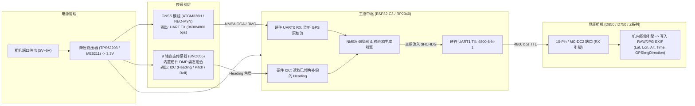
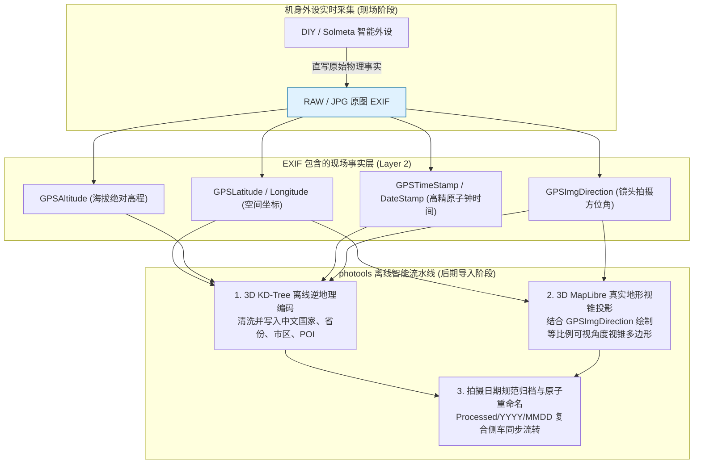

# 📸 尼康相机硬件 GPS 模块与电子罗盘（三轴磁力计）技术方案与协议规范指南

本文档全面梳理了针对尼康（Nikon）单反/微单相机的外接 GPS 硬件方案、NMEA-0183 通信链路、照片 EXIF GPS 元数据写入机制，以及如何集成
3 轴电子罗盘（磁力计）记录镜头拍摄朝向（`GPSImgDirection`）的完整技术指南。

---

## 目录

- [1. 概述与核心结论](#1-概述与核心结论)
- [2. 纯硬件透传方案剖析（以 4x1md/nikon_gps 为例）](#2-纯硬件透传方案剖析以-4x1mdnikon_gps-为例)
    - [2.1 硬件拓扑与电源管理](#21-硬件拓扑与电源管理)
    - [2.2 协议链路与波特率](#22-协议链路与波特率)
    - [2.3 尼康相机在 EXIF 中最终落盘的 GPS 标签全表](#23-尼康相机在-exif-中最终落盘的-gps-标签全表)
    - [2.4 纯透传方案的局限性](#24-纯透传方案的局限性)
- [3. 电子罗盘与三轴磁力计集成技术解析](#3-电子罗盘与三轴磁力计集成技术解析)
    - [3.1 为什么罗盘方案必须引入微控制器（MCU）？](#31-为什么罗盘方案必须引入微控制器mcu)
    - [3.2 尼康原生识别的罗盘航向语句：$HCHDG](#32-尼康原生识别的罗盘航向语句hchdg)
    - [3.3 扩展三维姿态语句：$PTNTHPR（Heading / Pitch / Roll）](#33-扩展三维姿态语句ptnthprheading--pitch--roll)
- [4. 全网成熟商业产品横向对比](#4-全网成熟商业产品横向对比)
- [5. 开源 DIY 硬件架构与选型指南](#5-开源-diy-硬件架构与选型指南)
    - [5.1 完整系统架构拓扑](#51-完整系统架构拓扑)
    - [5.2 核心元器件选型推荐](#52-核心元器件选型推荐)
    - [5.3 尼康机身专用接口与电气定义](#53-尼康机身专用接口与电气定义)
    - [5.4 固件核心处理逻辑与伪代码实现](#54-固件核心处理逻辑与伪代码实现)
    - [5.5 磁干扰与现场校准工程要点](#55-磁干扰与现场校准工程要点)
- [6. 与 photools 摄影工作流的协同关系](#6-与-photools-摄影工作流的协同关系)

---

## 1. 概述与核心结论

1. **尼康机身内置 NMEA 解释器**：尼康数码单反（D200、D300、D700、D800/D810/D850、D3/D4/D5/D6、D7000~D7500、D600/D610、D750/D780
   等）以及通过转接线的机型，机身固件内嵌了 NMEA-0183 串口解析器，通过热靴/机身侧面接口以 **4800 bps、8-N-1、TTL 电平**接收数据；
2. **纯透传模块可写基础地理信息**：仅需 GPS 模组直出 `$GPGGA` 与 `$GPRMC`，相机即可在照片 EXIF 中自动写入经纬度、海拔高度和
   UTC 原子钟时间，并实现机身时钟自动高精对时；
3. **镜头拍摄朝向需借助 `$HCHDG` 语句**：相机若要记录镜头拍摄朝向（`GPSImgDirection`），必须接收磁航向语句 `$HCHDG`
   ；若要记录俯仰与翻滚（Pitch/Roll），则依赖姿态语句 `$PTNTHPR`；
4. **罗盘必带 MCU 算力**：磁力计芯片全部基于 I2C/SPI 总线，必须借助微控制器（MCU，如 ESP32-C3、RP2040、STM32
   等）采集数据、执行重力加速度倾角补偿、格式化为 NMEA 语句后交织输出给机身。

---

## 2. 纯硬件透传方案剖析（以 4x1md/nikon_gps 为例）

开源项目 [4x1md/nikon_gps](https://github.com/4x1md/nikon_gps) 呈现了一种极为精简的**无单片机（MCU-less）**纯硬件透传方案。

### 2.1 硬件拓扑与电源管理

* **核心模组**：OriginGPS Hornet ORG1411 微型天线一体化模组（$10\times10\times3.8\,\text{mm}$，基于 SiRFstarIV 芯片）；
* **高效供电**：从相机 GPS 接口获取 5V~6V 输出，经 TI TPS62203 同步降压稳压至 3.3V（轻载效率 $>90\%$）；
* **休眠防跑电机制（核心亮点）**：
    - 传统 DIY 或廉价模块接上相机后，由于持续输出串口波形，会导致相机 **测光表（Exposure Meter）常开不待机**，1~2 小时吸干相机电池；
    - 该项目使用轻触按键配合施密特触发器（SN74LVC1G14）进行消抖，控制 ORG1411 的 `ON_OFF` 引脚进入 **40µA 极低功耗睡眠**；
    - 配合门控电平转换芯片（74AUP1T08 与 SN74LV1T126），休眠时串口 TX 自动转为高阻态（Hi-Z），让相机能够正常待机；由于休眠期间模组保留
      SRAM 星历与 RTC，唤醒后仅需 1~2 秒即可恢复“热启动”定位。

### 2.2 协议链路与波特率

* **物理层**：单向 UART TX，3.3V/5V TTL 电平；
* **波特率**：固定 4800 bps，8 个数据位，无校验，1 个停止位（4800-8-N-1）；
* **流式 NMEA 语句**：
    - `$GPGGA`（GPS 定位解算：时间、经纬度、定位质量、卫星数、海拔高程、大地水准面差距等）；
    - `$GPRMC`（推荐定位最小数据集：UTC 时间、日期、经纬度、有效状态）；
    - `$GPGSA`（GNSS DOP 精度稀释度与当前使用的活跃卫星号）。

### 2.3 尼康相机在 EXIF 中最终落盘的 GPS 标签全表

当相机接收到有效定位数据并释放快门时，机内图像处理器会将数据填入 EXIF GPS IFD（目录）中：

| EXIF 标签名 (Tag Name) | Tag ID   | 格式类型    | 来源 NMEA 语句      | 说明与规范值示例                                    |
|:-----------------------|:---------|:------------|:--------------------|:----------------------------------------------------|
| **`GPSVersionID`**     | `0x0000` | Byte[4]     | 机身固件生成        | 协议版本，通常记录为 `2.2.0.0` 或 `2.3.0.0`         |
| **`GPSLatitudeRef`**   | `0x0001` | ASCII[2]    | `$GPGGA` / `$GPRMC` | 纬度半球标志：`N`（北纬）或 `S`（南纬）             |
| **`GPSLatitude`**      | `0x0002` | Rational[3] | `$GPGGA` / `$GPRMC` | 拍摄点纬度（度/分/秒，如 `32 deg 6' 18.24" N`）     |
| **`GPSLongitudeRef`**  | `0x0003` | ASCII[2]    | `$GPGGA` / `$GPRMC` | 经度半球标志：`E`（东经）或 `W`（西经）             |
| **`GPSLongitude`**     | `0x0004` | Rational[3] | `$GPGGA` / `$GPRMC` | 拍摄点经度（度/分/秒，如 `34 deg 46' 35.12" E`）    |
| **`GPSAltitudeRef`**   | `0x0005` | Byte        | `$GPGGA`            | 海拔基准：`0` 代表海平面以上，`1` 代表海平面以下    |
| **`GPSAltitude`**      | `0x0006` | Rational    | `$GPGGA`            | 平均海平面（MSL）正高，单位米（如 `18.5 m`）        |
| **`GPSTimeStamp`**     | `0x0007` | Rational[3] | `$GPGGA` / `$GPRMC` | 高精度的原子钟 **UTC 时间**（时/分/秒）             |
| **`GPSDateStamp`**     | `0x001D` | ASCII[11]   | `$GPRMC`            | 拍摄当天的 **UTC 日期**（格式如 `2026:09:05`）      |
| **`GPSStatus`**        | `0x0009` | ASCII[2]    | `$GPRMC`            | 测量状态：`A`（有效解算 Active）或 `V`（无效 Void） |
| **`GPSMapDatum`**      | `0x0012` | ASCII       | 模组/机身标准       | 坐标参考椭球体，固定记录为 `"WGS-84"`               |
| **`GPSSatellites`**    | `0x0008` | ASCII       | `$GPGGA` / `$GPGSA` | 用于定位解算的卫星颗数（部分机型记录，如 `"08"`）   |
| **`GPSDOP`**           | `0x000B` | Rational    | `$GPGSA` / `$GPGGA` | 几何精度衰减因子（部分机型提取 HDOP 水平精度）      |

> **机身时钟自动同步（Auto Clock Sync）**：
> 尼康单反菜单中的 `设置 -> GPS -> 自动同步日期和时间`，在卫星锁定后会自动利用上述 `GPSTimeStamp` 与 `GPSDateStamp`
> 校正机身晶振时钟，彻底杜绝摄影师跨时区拍摄或长时间放置引起的时钟漂移。

### 2.4 纯透传方案的局限性

1. **无拍摄朝向（`GPSImgDirection` 留空）**：ORG1411 仅有卫星射频电路，无磁场敏感元件，静止拍摄时完全不知道镜头朝向；
2. **无对地速度与航迹（`GPSSpeed` / `GPSTrack` 忽略）**：手持拍摄速度接近 0，且尼康 GP-1 解析器默认不处理速度标签；
3. **无中文行政区划/地名**：GPS 硬件只输出经纬度数字，中文省/市/区县与景区 POI 需由后续离线逆地理编码（如 photools）补齐。

---

## 3. 电子罗盘与三轴磁力计集成技术解析

### 3.1 为什么罗盘方案必须引入微控制器（MCU）？

电子罗盘传感器（如 HMC5883L、QMC5883L、BMM150、LIS3MDL 等）在物理架构上与 GPS 模组存在根本差异：

1. **总线物理层不同**：磁力计芯片全部采用 **I2C 或 SPI 数字接口**，只输出三轴磁场原始分量寄存器值（$B_x, B_y, B_z$），无法自行产生
   ASCII 串口文本；
2. **必须实施倾角补偿（Tilt Compensation）**：
    - 摄影师在仰拍、俯拍或竖拍构图时，传感器平面不再水平；
    - 必须通过三轴加速度计（Accelerometer）测量重力矢量计算俯仰角（Pitch $\theta$）与翻滚角（Roll $\phi$），将三维地磁矢量旋转投影回水平面：
      $$X_h = X \cos\theta + Y \sin\phi \sin\theta + Z \cos\phi \sin\theta$$
      $$Y_h = Y \cos\phi - Z \sin\phi$$
      $$\text{Heading} = \text{atan2} (-Y_h, X_h)$$
3. **协议拼装与交织**：必须由 MCU 将计算得到的 Heading 按照 NMEA-0183 语法格式化，并与 GPS 模组的 GGA/RMC 语句混合以 4800
   bps 输出给相机。

### 3.2 尼康原生识别的罗盘航向语句：$HCHDG

尼康机身固件原生支持识别的电子罗盘语句为标准 NMEA **`$HCHDG`**（ **HC** = Heading Compass， **HDG** = Heading, Deviation &
Variation）：

```text
$HCHDG,xxx.x,,,,*hh<CR><LF>
```

* **字段详解**：
    - `xxx.x`：磁航向（Magnetic Heading，取值范围 `000.0` ~ `359.9` 度，保留 1 位小数）；
    - 第 2~5 个字段分别为：磁偏角偏差（Magnetic Deviation）、偏差方向（E/W）、磁偏角变化（Magnetic Variation）、变化方向（E/W）。在嵌入式实现中
      **通常留空**（用连续逗号分隔）或填入经地磁模型补偿后的真北偏角；
    - `*hh`：从 `$` 到 `*` 之间所有字符的十六进制 **异或校验和（XOR Checksum）**。
* **相机 EXIF 写入结果**：
    - `GPSImgDirectionRef`：记录为 `'M'`（Magnetic North）或 `'T'`（True North）；
    - `GPSImgDirection`：记录具体的角度浮点值（如 `128.5` 度）。

### 3.3 扩展三维姿态语句：$PTNTHPR（Heading / Pitch / Roll）

对于高阶 IMU 模块或支持 3D 姿态的设备（如 Solmeta、Vectornav、RoboGEO 体系），常向数据流中注入 Honeywell 姿态专有语句：

```text
$PTNTHPR,xxx.x,a,yyy.y,b,zzz.z,c*hh<CR><LF>
```

* `xxx.x, a`：水平朝向（Heading，0~359.9°）及有效状态标识（`N` 为正常）；
* `yyy.y, b`：相机俯仰角（Pitch，仰拍为正，俯拍为负，如 `+012.3`）；
* `zzz.z, c`：相机翻滚角（Roll，横滚/倾斜角，如 `-001.5`）。
* **写入特性**：部分高端尼康单反固件会提取其 Heading 存入 `GPSImgDirection`；对于机身未写入的 Pitch/Roll，ExifTool 支持从原始
  NMEA 日志中回填至 XMP 非标准扩展标签 `GPSPitch` 与 `GPSRoll`。

---

## 4. 全网成熟商业产品横向对比

| 品牌与型号                                  | 核心传感器                                               | 罗盘支持与特性                                                                                     | 接口支持                         | 优缺点分析                                                                 |
|:--------------------------------------------|:---------------------------------------------------------|:---------------------------------------------------------------------------------------------------|:---------------------------------|:---------------------------------------------------------------------------|
| **Solmeta Geotagger Pro 2**<br>(旗舰级)     | 高精度 GPS 模组 + 3 轴磁力计 + 3 轴加速度计 + 气压高度计 | **3 轴倾角补偿电子罗盘**，支持 $\pm90^\circ$ 俯仰翻滚姿态补偿；支持记录 Pitch/Roll；带 OLED 状态屏 | 尼康 10-pin 圆口 / MC-DC2 扁口   | **行业天花板**，功能极完备，内置锂电与航迹记录器；缺点是体积稍大且价格较高 |
| **Solmeta N3-Compass / GMAX**<br>(紧凑款)   | GPS/北斗双模 + 3 轴电子罗盘                              | 内置 3 轴罗盘，支持真北/磁北校准与切换，相机直接内嵌 `GPSImgDirection`                             | 热靴插座 + 专用线缆              | 体积紧凑，直插热靴，无屏幕但指示灯清晰                                     |
| **DawnTech di-GPS Eco ProSater Compass**    | MTK / SiRFstar IV + 微型三轴磁力计                       | 内置三轴罗盘，直接向机身输出 `$HCHDG`，支持拍摄朝向写入                                            | 直插式 10-pin 端子（无外挂飞线） | **极致轻巧**，硬币大小，直接拧在 D850/D5 端口上；已较难购买一手新品        |
| **Foolography Unleashed**<br>(现代蓝牙中继) | 纯 BLE 低功耗蓝牙桥接模块                                | **通过蓝牙从手机实时获取**：利用手机高精度指南针与 GPS 实时注入相机串口                            | 微型直插模块（超低凸起）         | 极低功耗，外观工业设计极佳；依赖手机后台常驻与蓝牙连接                     |
| **Nikon GP-1 / GP-1A**<br>(尼康原厂已停产)  | SiRFstar III / IV 单 GPS 模组                            | **无电子罗盘**，仅能记录经纬度、海拔和时间                                                         | 10-pin 圆口 / 扁口切换线缆       | 原厂兼容性好但功耗大（容易导致测光表常开吸干电池），无航向功能             |
| **尼康机身内置 GPS**<br>(D5300 / Z 9)       | 机身集成 GNSS 天线与芯片                                 | **无电子罗盘**（Z 9 与 D5300 均无内置磁力计，不写朝向）；仅 Coolpix AW130 等三防卡片机内嵌罗盘     | 机身内置集成                     | 免外挂设备，但无法在单反/微单旗舰上获取照片镜头朝向                        |

---

## 5. 开源 DIY 硬件架构与选型指南

如果要自行设计并制作一款 **具备经纬度 + 海拔 + 电子罗盘拍摄朝向**的现代化尼康 GPS 伴侣，推荐采用以下经过工程验证的架构体系：

### 5.1 完整系统架构拓扑



### 5.2 核心元器件选型推荐

1. **主控 MCU**：
    - **ESP32-C3**（推荐）：成本约 ¥8，具备多个硬件串口和 I2C，支持深度休眠（$<5\mu\text{A}$），内置 BLE 未来可扩展手机无线控制；
    - **RP2040（树莓派单片机）**：双核 ARM Cortex-M0+，硬件 PIO 可极其精准模拟任意波特率串口。
2. **GNSS 定位模组**：
    - **中科微 ATGM336H**（高性价比）：支持北斗三号+GPS 双模，灵敏度 $-162\,\text{dBm}$，支持自定义默认波特率与更新频率；
    - **u-blox NEO-M8N / M9N**（高精度工业级）：弱信号抗干扰与多径效应表现卓越。
3. **电子罗盘 / 姿态传感器**：
    - **Bosch BNO055（强烈推荐）**：集成 3 轴磁力计 + 3 轴加速度计 + 3 轴陀螺仪， **内置 32-bit Cortex-M0 运行 BSX3.0
      融合算法**，直接输出无需主控计算的绝对欧拉朝向角（已硬件自动完成倾角补偿），免去手写卡尔曼滤波的巨大复杂度；
    - **QMC5883L / LIS3MDL**（成本方案）：纯磁力计，必须额外搭配加速度计（如 MPU6050/ADXL345）由主控代码完成倾角投影。

### 5.3 尼康机身专用接口与电气定义

尼康单反主要分为两大硬件接口体系：

#### 1. 经典 10-Pin 金属圆形遥控插座（中高端单反：D200、D300、D700、D800/D810/D850、D3~D6）

* **Pin 1**：`VCC`（相机输出供电，通常为 $5.0\text{V} \sim 6.0\text{V}$）；
* **Pin 4**：`GND`（系统地）；
* **Pin 5**：`GPS_TXD`（数据流向： **外设 TX 发送给相机机身 RX**，4800 bps，TTL 电平）；
* **Pin 9**：`Shutter`（快门触发脚，下拉至 GND 触发快门）；
* **Pin 10**：`Focus`（对焦触发脚，下拉至 GND 触发半按对焦）。

#### 2. MC-DC2 矩形扁口插座（中入门级单反：D90、D7000~D7500、D600/D610、D750）

* 共有 8 针或 4 针接线柱，同样包含 `Power (5V)`、`GND`、`Serial In (GPS RX)`、`Focus`、`Shutter`。

> [!WARNING]
> **电平安全与反接保护**：
> 尼康相机机身串口输入口容限为 3.3V ~ 5V TTL，严禁直接输入 RS-232 负压电平（否则会击穿机身 I/O 芯片）；建议在 MCU
发送脚与相机输入脚之间串联一个 $300\,\Omega$ 限流电阻，并在电源端加入肖特基防反接二极管。

### 5.4 固件核心处理逻辑与伪代码实现

```cpp
#include <Arduino.h>
#include <Wire.h>
#include <Adafruit_Sensor.h>
#include <Adafruit_BNO055.h>

// 硬件串口定义
#define SerialGPS   Serial1 // 连接 GPS 模块 (如 9600 bps)
#define SerialNikon Serial2 // 连接 尼康机身 (固定 4800 bps)

Adafruit_BNO055 bno = Adafruit_BNO055(55, 0x28);
unsigned long lastHeadingTime = 0;

void setup() {
    SerialGPS.begin(9600);
    SerialNikon.begin(4800, SERIAL_8N1); // 尼康标准要求
    
    Wire.begin(4, 5); // SDA, SCL
    if (!bno.begin()) {
        // 罗盘初始化异常处理
    }
    bno.setExtCrystalUse(true);
}

// 计算 NMEA 异或校验和
uint8_t calculateNMEAChecksum(const char* sentence) {
    uint8_t checksum = 0;
    while (*sentence) {
        checksum ^= *sentence++;
    }
    return checksum;
}

// 发送格式化的 $HCHDG 语句给尼康
void sendNikonHeading(float headingDegrees) {
    char payload[32];
    // 格式: HCHDG,xxx.x,,,,
    snprintf(payload, sizeof(payload), "HCHDG,%.1f,,,,", headingDegrees);
    
    uint8_t cs = calculateNMEAChecksum(payload);
    
    SerialNikon.print("$");
    SerialNikon.print(payload);
    SerialNikon.print("*");
    if (cs < 0x10) SerialNikon.print("0");
    SerialNikon.println(cs, HEX);
}

void loop() {
    // 1. 高优先级透传 GPS 的标准 GGA / RMC 语句流
    while (SerialGPS.available()) {
        char c = SerialGPS.read();
        SerialNikon.write(c);
    }

    // 2. 以 1Hz 频率注入机位电子罗盘朝向
    if (millis() - lastHeadingTime >= 1000) {
        sensors_event_t event;
        bno.getEvent(&event);
        
        // event.orientation.x 为 0~359.9° 绝对朝向 (已倾角补偿)
        float heading = event.orientation.x;
        
        sendNikonHeading(heading);
        lastHeadingTime = millis();
    }
}
```

### 5.5 磁干扰与现场校准工程要点

1. **硬铁（Hard Iron）与软铁（Soft Iron）干扰隔离**：
    - 相机机身的镁合金骨架、镜头内部的超声波马达（SWM/AF-P 步进马达）、机顶闪光灯高压电容与热靴金属簧片均会产生局部强杂散磁场；
    - 罗盘模块在物理结构上应 **尽量架高在热靴顶部上方 $2 \sim 3\,\text{cm}$**（远离机身顶盖），避免强磁场饱和；
2. **简易八字校准法（Figure-8 Calibration）**：
    - 搭载 BNO055 时，开机后手持相机在空中做水平与三维“8”字旋转 3~5 秒，BNO055 的片上系统会自动计算偏置向量并完成动态自校准。

---

## 6. 与 photools 摄影工作流的协同关系

在现代摄影资产管理流水线中， **硬件外设**与 **photools 软件系统**呈现清晰的分工协作闭环：



1. **硬件外设负责“第一手物理事实”的绝对真实记录**：
    - 经度、纬度、海拔高程、高精 UTC 时间，以及由 3 轴电子罗盘提供的精确镜头朝向（`GPSImgDirection`）。
2. **photools 负责“第二/三层语义扩展与空间还原”**：
    - **离线中文地名清洗**：利用 3D KD-Tree 离线数据库将经纬度转换为标准中文行政区划与景点 POI；
    - **3D 真实地形视锥（Perspective Cone）投影**：结合照片的焦距（Focal Length）、传感器尺寸（计算水平视角 FOV）与硬件记录的朝向（
      `GPSImgDirection`），在 3D 数字高程模型（DEM）卫星地图上实时投射等比例贴地视锥多边形，完美还原拍摄机位与视线穿透地貌；
    - **绝对幂等性规范归档**：依据相机内的原子钟时间将资产组织至 `Processed/YYYY/MMDD/` 规范化目录中。
