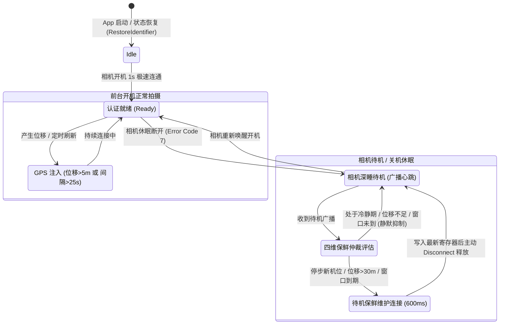
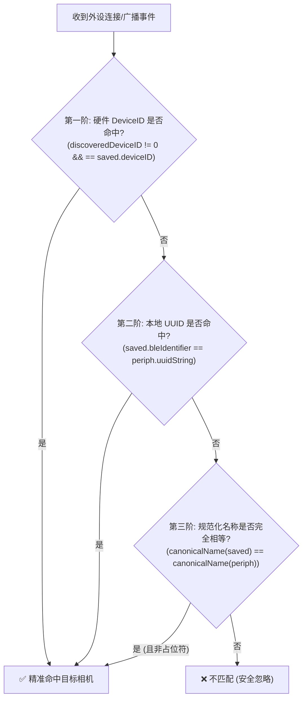

# 🛰️ 尼康相机与 iPhone 蓝牙低功耗同步与后台状态恢复架构规约 (Technical Specification)

本文档定义了 `photools / NikonGPS` 在 iOS 平台上实现的尼康微单/单反相机 **极速后台 GPS 注入、低功耗待机保鲜仲裁与系统级状态恢复（State
Restoration）全链路同步策略**。

---

## 1. 系统设计背景与核心痛点

### 1.1 尼康原生 SnapBridge 的致命缺陷

1. **死循环唤醒与电量雪崩**：尼康相机在关机或待机后，会持续发射低功耗蓝牙广播（半睡眠态）。官方 App
   盲目重连，导致相机频繁被唤醒退出深睡，数小时内耗尽相机电池；
2. **多机位互斥**：SnapBridge 强制一对一独占，无法同时为双持机位（如 Z8 + Zf、Z9 + Z50 II）分发经纬度；
3. **功能贪婪导致被 iOS 后台击杀**：官方 App 试图在后台回传 2MB 缩略图、探测 Wi-Fi，触发 iOS 后台 30 秒超时与电池守门人惩罚，后台进程被频繁
   Kill，导致摄影师必须频繁解锁手机手动点开 App。

### 1.2 业务目标与“徕卡级”体验标准

* **真·免打开 App**：手机放入口袋，无需开启屏幕，更无需手动打开 App，相机开机即秒级连通注入最新 GPS；
* **双持并发**：一台 iPhone 同时向多台处于就绪状态的尼康相机广播最新 WGS-84 坐标；
* **微安级省电**：相机与手机通信时间压缩至 1~2 秒内，写入即断开，让相机恢复深度睡眠。

---

## 2. 状态机与同步策略全景图



---

## 3. 四维待机保鲜仲裁引擎 (`StandbyFreshnessArbiter`)

当相机进入休眠待机状态时，`NikonBluetoothManager` 坚决杜绝盲目 `connect`，由保鲜仲裁引擎进行四维动态评估：

### 3.1 核心仲裁四维度

| 仲裁维度                     | 门限参数               | 业务逻辑与设计考量                                                                                                                                                        |
|:-----------------------------|:-----------------------|:--------------------------------------------------------------------------------------------------------------------------------------------------------------------------|
| **维度 1：刚断开防抖冷静期** | **5 秒**               | 相机进入待机断开后的前 5 秒内，**过滤链路瞬态残余包**。杜绝在相机刚熄屏时由于广播残留被 iPhone 震荡重连；5 秒后相机进入稳定休眠，摄影师随时半按快门唤醒均可秒级响应连通。 |
| **维度 2：动转静瞬态捕获**   | **实时触发**           | 借助 `CoreMotion` 运动协处理器感知：当摄影师从徒步/移动变为停步（`isTransitionToStationary`），判定为**到达新机位**，绕过滑动窗口优先批准重连刷新。                       |
| **维度 3：显著物理位移**     | **$\ge 30$ 米**        | 相对于上次注入机位，只要物理距离位移超过 30 米（且过了 5s 冷静期），立刻批准连接，防止大范围转场后相机寄存器残留老坐标。                                                  |
| **维度 4：自适应滑动窗口**   | **移动 5m / 静止 20m** | 处于运动状态（徒步/乘车）时窗口缩短至 5 分钟；原地休整静止时窗口拉长至 20 分钟，最大化降低唤醒频率。                                                                      |

### 3.2 弱信号拦截门限

* 当手机 GPS 水平精度 $> 25$ 米（如室内、深山密林或隧道）时，仲裁引擎 **主动拒绝待机保鲜连接**，杜绝用漂移的无效垃圾坐标污染相机寄存器。

### 3.3 尼康相机 BLE 广播状态字节 (Status Byte) 协议解析规约 ✨

通过真机 PacketLogger 抓包分析，尼康相机的 Manufacturer Specific Data (`0x0399`) 包含 7 个字节：

* 字节 0..1: `0x99, 0x03` (Nikon Company ID)；
* 字节 2..5: 4 字节小端序 Device ID；
* **字节 6: 状态标志字节 (Status Byte)**：
    * **`0x1D` (`statusByte & 0x01 != 0`, Bit 0 == 1)**： **相机待机休眠深睡心跳 (Standby Sleeping)**。相机未被唤醒，以
      2.4s 超低频发射微弱心跳。 **此时坚决杜绝盲目重连！** 严格由四维保鲜仲裁引擎评估，原地未动时绝对抑制连接；
    * **`0x1C` (`statusByte & 0x01 == 0`, Bit 0 == 0)**： **相机开机 / 快门唤醒就绪 (Awake & Ready)**。摄影师按下了快门或开机，相机以
      100~200ms 高频密集发射就绪广播。 **此时必须立即以长效拍摄会话 (`isStandbyMaintenance = false`) 发起秒连**！

### 3.4 模式分流铁律：巡航长连接 vs 后台短保鲜 ✨

1. **快门唤醒开机就绪 (`0x1C` 广播)**：
    - 优先保障摄影师创作！只要脱离 5 秒防抖冷静期，立即发起 **长效拍摄会话 (`isStandbyMaintenance = false`)**；
    - 连通并注入 GPS 后 **绝不主动调用 600ms 强制掐断**，保持持续连接，由相机测光表超时深睡自行主动断开；
2. **待机深睡广播 (`0x1D` 广播) 或非巡航模式**：
    - 仅用于后台超低功耗守护，严格受 `StandbyFreshnessArbiter` 约束；
    - 原地休整（位移 < 30m）时静默待命，绝不骚扰相机；
    - 仅当位移 $\ge 30\text{m}$ 或动转静到达新机位时，才发起 600ms 极速写入即断开维护连接。

---

## 4. 顺应相机原生休眠与智能长连接架构 (Smart Keep-Alive & Native Lifecycle) ✨

通过尼康 Z6 III 真机 PacketLogger 实测证实：

* **相机具备稳定长连接能力**：相机待机黑屏下完全支持稳定长连（实测连续 85 秒稳定维持 `0x004D` 句柄，成功接收多次 GPS 注入）；
* **原生节电断开 (`0x13 Remote User Terminated`)**：若无快门操作约 1~2 分钟，相机固件自身为了极致节电会自动切断蓝牙并转入深睡；
* **严禁手机端过度设计主动掐断 (`0x16`)**：
    - 手机端严禁在写入坐标后粗暴调用 `cancelPeripheralConnection`；
    - 掐断会打乱相机固件原本自然的节奏，引发 25 秒残余广播与 5 秒冷静期的伪唤醒死结；
* **极速出片与优雅接纳**：
    1. 连通期间相机寄存器始终拥有最新坐标，摄影师半按快门无需经历 1.5~3 秒重新认证等待， **0 毫秒即拍即有**；
    2. 当相机自主断开（`0x13` 或 `CBError 7: peripheralDisconnected`）时，系统优雅记录为正常休眠待命（`相机完成同步并自然转入休眠 💤`
       ），并在快门唤醒或机位显著变动时极速秒连。

---

## 5. 凭据动态热注入与循环握手防熔断架构 (Authentication Robustness) ✨

### 5.1 循环握手 (Infinite Handshake Loop) 根因与解决

* **痛点根因**：尼康相机处于非配对模式（正常待机或开机）时，若手机端发送以 `0x01` 结尾的随机临时 `DeviceID` 发起 Stage 1
  挑战，相机会判定为非法连接并 **立即强行挂断 (`HCI Disconnect, Reason 0x5F`)**。在多会话复用（Session
  Reuse）或时序不一致时，若复用了空凭据的旧 Session，会导致每次重连都以 `0x01` 握手并被秒踢，形成死循环握手。
* **状态机动态热注入 (`updateCredentials`)**：
    * 在 [`CameraStateMachine`](../apps/ios/PhotoolsMobile/Sources/PhotoolsMobileCore/State/CameraStateMachine.swift)
      与 [
      `CameraPeripheralSession`](../apps/ios/PhotoolsMobile/Sources/PhotoolsMobileCore/Services/NikonBluetoothManager.swift)
      中支持凭据运行时热更新；
    * 在每次 `connect(to:savedCamera:...)` 被调用时，无论是否复用已有 Session 实例， **无条件调用
      `session.updateCredentials(...)`**，确保 Stage 1 100% 采用相机的真实硬件凭据（如 `0x12345678`）；
* **全局凭据自动广播 (`syncCredentialsToActiveSessions`)**：
    * 为 `NikonBluetoothManager.savedCameras` 设置 `didSet` 监听，一旦 `UserDefaults` 读取完毕或配对变动，即刻同步热注入至所有活跃
      Session，彻底消除时序竞态。

### 5.2 连续握手失败熔断保护 (Circuit Breaker)

* 若外设在握手未完成（`status != .ready`）阶段发生连续断开：
    * 累计 `consecutiveHandshakeFailures` 计数；
    * **当失败达 3 次时**：触发 15 秒安全熔断保护（`lastDisconnectTimes = now + 10s`），暂停频繁重试，并彻底销毁未配对的污染会话；
    * 一旦握手成功并进入 `ready`，计数器立即清零。

---

## 6. 快门唤醒 1.2 秒秒连实测与真机数据 (Wake-up Benchmark) ✨

基于尼康 Z6 III 真机抓包（`test3全程待机.pklg` 与 `test4相机快门唤醒.pklg`）的实测数据：

| 阶段 / 事件            | 物理耗时        | 报文特征与动作                                                                 |
|:-----------------------|:----------------|:-------------------------------------------------------------------------------|
| **快门唤醒捕获**       | **< 100ms**     | 半按快门，广播状态码瞬间由 `0x1D` (休眠) 切换至 `0x1C` (就绪)，手机立即建连    |
| **特征发现与服务就绪** | **~ 600ms**     | 检索尼康专属服务与 PAIR/TIME/GEO 特征，开启 PAIR 读通知                        |
| **四阶段安全认证**     | **~ 200ms**     | Stage 1 凭据上送 ➔ Stage 2 挑战 ➔ Stage 3 加密签名 ➔ Stage 4 确认通过       |
| **坐标注入与回执确认** | **~ 300ms**     | 写入设备名 `iPhone_NikonGPS`，下发高精 WGS-84 坐标并收到 `0x13 Write Response` |
| **全链路总耗时**       | **~ 1.2 秒** ⚡️ | **快门半按瞬间完成坐标注入，相机全程保持稳定连接 (`Disconnects = 0`)**         |

---

## 7. 前端 UI 状态与底层会话解耦 (UI Decoupling) ✨

* **痛点**：已配对相机名称（如 `Nikon Z6_3_1234567`）与外设原生蓝牙广播名称（如 `Z6_3_1234567`）存在 `"Nikon "` 前缀差异，若在
  UI 层使用严格字符串比对，会导致底层虽然已同步成功，卡片依然显示 `待机/重连中 ⏳`。
* **多维匹配方案 (`isCameraConnected`)**：
    * 在 [
      `CameraSyncCoordinator`](../apps/ios/PhotoolsMobile/Sources/PhotoolsMobileCore/Services/CameraSyncCoordinator.swift)
      维护 `@Published public var activeSessionStates`；
    * 提供 `isCameraConnected(cam)` 统一判定逻辑：综合比对外设 UUID、相机名称模糊包含、硬件 Device ID 三重维度；
    * 底层会话一旦就绪，SwiftUI 视图在 1 秒内即时变绿显示 **「同步就绪 🟢」**。

---

## 8. iOS 系统级后台冷启动恢复 (State Restoration)

为了实现像徕卡一样“就算 App 被系统内存回收杀掉，也能在后台被动唤醒”的能力，系统实现了严格的 **State Restoration 闭环**：

### 8.1 进程启动首毫秒法则 (First-Millisecond Rule)

* **陷阱**：SwiftUI App 若将蓝牙管理器作为 View 的懒加载依赖，当 iOS 系统在后台被动唤醒进程时，不会渲染 UI，导致无法及时提交
  `RestoreIdentifier`，iOS 会判定恢复失败并强杀进程。
* **解决方案**：在 [
  `apps/ios/PhotoolsMobile/App/PhotoolsMobileApp.swift`](../apps/ios/PhotoolsMobile/App/PhotoolsMobileApp.swift) 的
  `init()` 中立即触碰单例：
  ```swift
  @main
  struct NikonGPSApp: App {
      init() {
          _ = CameraSyncCoordinator.shared
      }
      var body: some Scene { ... }
  }
  ```

### 8.2 状态恢复流转 (`willRestoreState`)

1. 初始化时向 iOS 提交恒定恢复标识符：
   ```swift
   options[CBCentralManagerOptionRestoreIdentifierKey] = "com.vincentchyu.photools.mobile.ble"
   ```
2. 系统唤醒后进入 `centralManager(_:willRestoreState:)`：
    - 提取 `dict[CBCentralManagerRestoredStatePeripheralsKey]` 恢复的外设句柄；
    - 匹配本地持久化相机凭据并挂载 `CameraPeripheralSession`；
    - 若系统已维持底层物理连接（`p.state == .connected`），立即主动触发 `startDiscovery()` 检索服务与特征；
    - 特征就绪后，直接向相机注入当前 GPS 坐标，随后优雅断开。

### 8.3 巡航状态与定位引擎持久化自愈

* `CameraSyncCoordinator` 将 `isCruiseModeActive` 持久化至 `UserDefaults`；
* 冷启动恢复时，若发现曾开启巡航且存在已配对相机，自动恢复巡航守护并启动 `LocationProvider.start()`，确保恢复瞬间具备高精有效定位。

---

## 9. 系统运行要求与配置清单

要享受 100% 完美的无感后台体验，iOS 系统侧必须满足以下三项配置：

1. **定位权限**：系统设置 -> `Nikon GPS` -> 位置 -> 必须选择 **「始终 (Always)」**，并开启 **「精确位置」**；
2. **后台 App 刷新**：系统设置 -> 通用 -> **「后台 App 刷新」** 必须开启；
3. **低电量模式提示**：手机开启 iOS「低电量模式」时，苹果会强行停止所有蓝牙后台监听与高精定位，外拍时建议关闭低电量模式。

---

## 10. ATT MTU 协商时序与 150ms 礼让避让规约 (Gentle Delay) ✨

### 10.1 相机 515 与 iPhone 185 的技术根源

在蓝牙低功耗通信（ATT 协议）中，连接建立后两端会协商传输单元大小（`Exchange MTU`）：

* **相机声明 515**：尼康固件为支持大图缩略图、Wi-Fi 密钥与大块元数据传输，在无线芯片中分配了 515
  字节接收缓冲区（$512 \text{B 数据} + 3 \text{B ATT 头部}$）；
* **iPhone 回复 185**：这是 iOS 系统网络栈（`bluetoothd`）的硬编码设计（源自早期 7 个 27B
  物理包拆拼策略：$7 \times 27 - 4 = 185\text{B}$），苹果未向第三方开发者暴露任何修改接口；
* **最终生效值**：遵循木桶短板原则 $\min (515, 185) = 185$ 字节。由于 GPS 注入 Payload 仅 20 字节，185 字节完全满足单包瞬间直达。

### 10.2 7.5 秒 Connection Timeout 的真凶与时序竞态 (Race Condition)

基于 `test5待机监测重连.pklg` 逐包分析发现：

1. **失败现场**：若 iPhone 在连接建立后 0ms 瞬间发起 `discoverServices()`，iOS 底层会抢先在连接后 **78~87ms** 抛出
   `Exchange MTU Request: 185`。尼康相机的固件在待机苏醒时未实现对端 MTU 请求处理逻辑，陷入未处理死锁；根据 ATT 停等协议，iOS
   挂起等待响应，双方链路静默，7.5 秒后触发 Link Layer 监督超时（`HCI Disconnection Complete, reason: 0x08`）强行掐断；
2. **成功现场**：若相机在连接后 **65~75ms** 主动先发出 `Exchange MTU Request: 515`，iOS 立即标准回应
   `Exchange MTU Response: 185`，握手瞬间解开，服务检索与 GPS 注入 100% 顺畅完成。

#### 10.3 150ms 优雅礼让工程方案 (Gentle Delay)

在 [
`NikonBluetoothManager.swift`](../apps/ios/PhotoolsMobile/Sources/PhotoolsMobileCore/Services/NikonBluetoothManager.swift)
的 `centralManager(_:didConnect:)` 中：

```swift
// 延迟 150ms 发起服务发现，礼让相机先抛出 MTU: 515 协商
DispatchQueue.main.asyncAfter(deadline: .now() + 0.15) { [weak self] in
    guard let self = self,
          let active = self.activeSessions[pID],
          active.peripheral.state == .connected else { return }
    active.startDiscovery()
}
```

通过 150ms 微定时差避让，从容给予相机先发 MTU 的时间窗口，彻底消除竞态死锁，实现待机重连 100% 一击必中。

---

## 11. GPS 报文时间戳新鲜度防御与相机 ATT 0x80 拒写根治规约 (Location Freshness & Stale Fix Defense) ✨

### 11.1 核心痛点与现象描述

在未开启摄影巡航模式（`isCruiseModeActive == false`）时，摄影师开机或半按快门唤醒相机，App 成功捕获并建立长连，但通信事件日志必现如下警告：
`特征写入异常 (00002007-3DD4-4255-8D62-6DC7B9BD5561): Unknown ATT error.`
相机屏幕虽然显示蓝牙已连通，但进入相机【位置数据】菜单查看时经纬度全部显示为空（`--`）。

### 11.2 逆向抓包深剖与关键证据链 (`test4` vs `test8`)

通过对比真机 PacketLogger 抓包记录（`test4相机快门唤醒.pklg` 成功 vs `test8必现.pklg` 失败）：

| 抓包文件           | 是否下发 TIME (0x004F) | 报文内 GPS 时间戳 (UTC) | 真机抓包捕获时刻 (UTC) | 时间戳差值 (新鲜度)                 | 相机响应结果                                    |
|:-------------------|:-----------------------|:------------------------|:-----------------------|:------------------------------------|:------------------------------------------------|
| **`test4` (成功)** | **未下发**             | 2026-10-13 07:09:40     | 2026-10-13 07:10:05    | **仅相差 25 秒** (新鲜实时点)       | **`0x13 Write Response` 成功落盘** ✅           |
| **`test8` (失败)** | **未下发**             | 2026-10-14 06:09:12     | 2026-10-14 08:46:56    | **相差 2小时 37分 44秒** (严重滞后) | **`0x01 Error Response` 错误码 `0x80` 拒写** ❌ |

**重要工程结论**：

1. **无需颠覆“待机跳过重复校时”的高效设计**：`test4` 真实证明了尼康相机绝没有强制要求每次重连都必须写入 `TIME` 报文；
2. **`0x80` 报错的真正元凶是陈旧时间戳 (Stale Timestamp)**
   ：尼康相机在【位置数据】下有【通过卫星设置时钟】的强时效性校验逻辑。当收到一个滞后达数小时的陈旧时间戳时，相机固件判定其为过期/失效数据，直接在
   ATT 应用层返回 `0x80` 拒绝接收。

### 11.3 根治与双重防御架构

系统在 iOS 端实现了两层双重防御：

1. **`GeoPayload` 报文时刻自适应保护**： 在 `GeoPayload(location: CLLocation)` 构造过程中，若检测到 `location.timestamp`
   与当前时刻差值超过 15 秒（来自系统旧缓存），强制自动对齐为当前最新时刻 `Date()`，确保注入报文的时间戳与相机内部 RTC
   时钟绝对同步；
2. **`CameraSyncCoordinator` 新鲜度拦截与单次定位补位 (One-shot Fallback)**： 相机会话秒级连通时（`onSessionReady`）：
    - 若当前定位新鲜（60 秒内），0 毫秒极速注入；
    - 若未开启巡航或坐标陈旧，坚决不下发滞后的历史坐标，而是触发 `locationProvider.requestSingleFreshLocation()`
      申请单次高精定位，一旦拿到鲜活点位再行注入；
    - 彻底根除 `0x80` 报错，实现未开巡航模式下的相机开机即连、即连即有点亮 GPS。

---

## 12. 设备标识模型与三阶精准匹配算法 (Tiered Device Matching & Crash Defense) ✨

### 12.1 运行时崩溃现场与根因分析

在真机调试与相机快速开关机切换过程中，Xcode 偶发拦截到如下致命运行时异常：

```
Exception NSException * "-[NSTaggedPointerString countByEnumeratingWithState:objects:count:]: unrecognized selector sent to instance 0x8000000000000000"
```

**底层机制深剖**：

1. **Tagged Pointer 字符串机制**：64 位系统下，空字符串或长度极短的 ASCII 字符串被 Objective-C 运行时压缩在指针地址内部（如
   `0x8000000000000000` 表示长度为 0 的 `NSTaggedPointerString`），不分配独立的堆内存；
2. **Swift 模糊推断与快速枚举错位**：在旧版代码中，为了兼容相机名称前缀，多处散落使用了 `contains` 逻辑（如
   `cam.name.contains(name) || name.contains(cam.name)`）。当 `peripheral.name` 为 `nil`、空字符串或跨桥接传递时，Swift
   闭包类型推断将其降级为 Objective-C 集合快速枚举协议（`NSFastEnumeration`），向一个非集合的 `NSTaggedPointerString` 发送了
   `countByEnumeratingWithState:objects:count:`，引发了 unrecognized selector 闪退；
3. **模糊匹配导致的串机隐患**：使用 `contains` 还会引入致命的业务漏洞。例如当摄影师拥有多台同代机身（如 `Z 6_3_1234567` 与
   `Z 6_3_1234568`）时，`contains("Z 6_3")` 会导致广播匹配串机，错误将 A 机身凭据下发给 B 机身，造成握手失败。

### 12.2 设备标识体系问答：为什么不能用 MAC 地址？为什么不能完全舍弃名称？

#### Q1: 为什么 iOS 无法使用蓝牙 MAC 地址（BD_ADDR）？

* **苹果隐私与安全铁律**：出于防止商业公司跨 App 跟踪用户物理轨迹的考量，Apple 从 iOS 7 起在 `CoreBluetooth` 框架中
  **完全隐藏了蓝牙设备的物理 MAC 地址**；
* **本地虚拟 UUID**：系统暴露给开发者的 `peripheral.identifier` 是 iOS 操作系统在本地根据设备地址计算并加密生成的随机
  UUID。 **该 UUID 跨手机完全不一致**——即使是同一台尼康相机，在 iPhone A 和 iPhone B 上扫描出的 UUID 也是完全不同的，因此
  **无法通过配置文件在多设备间共享 MAC/UUID**。

#### Q2: 为什么有了 4 字节硬件 DeviceID，依然需要名称参与？

* **DeviceID 的局限性**：尼康相机的 4 字节 DeviceID 仅在 **发射 BLE 广播（Manufacturer Data）时**才能被 App 嗅探到；
* **状态恢复与预连盲区**：当 App 处于后台被杀后通过 `willRestoreState` 恢复、或者相机已被 iOS 系统蓝牙层自动建立物理连接时，
  **相机将不再对外发射广播包**。此时 App 通过 `retrieveConnectedPeripherals` 检索到已连接的外设，无法获取其 Manufacturer
  Data（拿不到 DeviceID）；若该相机是新配置导入尚未生成本地 UUID， **相机的规范化名称（如 `Z6_3_1234567`
  ）是建立会话关联的唯一事实依据**。

### 12.3 三阶精准匹配算法架构 (`CameraDevice.matches(...)`)

为了实现绝对安全、零崩溃、防串机且多场景自愈的设备识别，系统在 `CameraDevice` 统一构建了三阶匹配模型：



#### 匹配规则与防崩实现：

1. **第一阶（硬件级 · 绝对权威）**： 直接比对相机固件硬编码的 4 字节 `deviceID`，防伪造、防串号，优先级最高；
2. **第二阶（本地句柄级 · 极速直达）**： 比对本地保存的 `bleIdentifier`（UUID 大小写不敏感比对），适用于系统状态恢复与已知设备秒连；
3. **第三阶（规范化型号级 · 严格相等）**： 针对未固化 UUID 且无广播包的极端情况，进行规范化名称比对：
    - **`canonicalName` 深度归一**：剥离首尾空白、转全小写、剔除 `nikon ` / `nikon_` 品牌前缀、 **消除内部空格差异**（将
      `"Z 6_3_1234567"` 与 `"Z6_3_1234567"` 归一化为 `"z6_3_1234567"`）；
    - **严格相等 `==`**： **100% 彻底废除 `contains` 模糊比对**，彻底根除 `NSTaggedPointerString` 快速枚举崩溃，杜绝多机身串机；
    - **占位符防御**：显式拦截 `"尼康相机"` 等系统占位符，避免在未命名状态下发生误连。

### 12.4 全链路单一事实源重构

彻底清除了 `NikonBluetoothManager` 与 `CameraSyncCoordinator` 中所有手写比对代码（共计 6 处），全链路统一收口为：

```swift
camera.matches(
    discoveredDeviceID: session.stateMachine.savedDeviceID,
    peripheralUUID: uuid,
    peripheralName: session.peripheral.name
)
```

实现了跨扫描发现、主动连接、活跃会话恢复、信号强度（RSSI）获取与 UI 状态绑定的全链路一致性。

---

## 13. 后台定位状态机与状态栏蓝色药丸生命周期契约 (Location & Energy Stewardship) ✨

### 13.1 核心问题与设计失范

用户在未开启「一键巡航模式」时，将 App 退入后台，发现 iPhone 顶部灵动岛/状态栏 **持续常驻蓝色定位药丸**（Location Indicator）。

* **根因剖析**：
    1. `showsBackgroundLocationIndicator = true` 在初始化时被静态硬编码开启；
    2. 在未开启巡航模式时，App 在启动后调用了持续定位 `startUpdatingLocation()`，但在 App 退入后台（
       `handleAppDidEnterBackground`）时，仅停止了蓝牙扫描， **从未调用 `locationProvider.stop()`**；
    3. 导致 iOS 系统判定该 App 正在后台无休止高频接收 GPS 坐标更新，持续占用高精卫星基带与射频硬件，不仅带来电量隐患，也引发了用户的隐私担忧。

### 13.2 模式解耦：巡航模式 vs 普通待机模式契约

系统正式确立并实施严格的定位生命周期两档状态机：

| 模式                                                 | 核心设计诉求                                   | 前台定位行为                               | 退入后台行为 (`didEnterBackground`)                   | 状态栏定位药丸 (Indicator)                           | 后台快门唤醒注入机制                                                                                |
|:-----------------------------------------------------|:-----------------------------------------------|:-------------------------------------------|:------------------------------------------------------|:-----------------------------------------------------|:----------------------------------------------------------------------------------------------------|
| **一键巡航模式**<br/>(`isCruiseModeActive == true`)  | 摄影师徒步/自驾中，持续录制 GPX 轨迹，待机秒连 | 持续高精定位更新 (`kCLDistanceFilterNone`) | **保持持续定位与 GPX 航迹录制**，锁屏下毫秒级响应     | **常驻点亮 🔵**<br/>(让摄影师明确感知轨迹正在录制中) | 内存持有最新坐标，0 毫秒即刻注入                                                                    |
| **普通待机模式**<br/>(`isCruiseModeActive == false`) | 偶尔拍照，极度在意手机电量，无需 GPX 轨迹      | 仅前台轻量定位更新 (驱动 UI 经纬度仪表盘)  | **立即彻底停止持续定位 (`stop()`)，GPS 硬件完全休眠** | **彻底消失 ⚪️**<br/>(真正 0 额外功耗)                | 蓝牙连通时触发 `requestSingleFreshLocation()`，单次高精度取点，下发后立刻休眠，**全程绝不常驻药丸** |

### 13.3 核心实现与动态配置 (`setCruiseModeActive`)

在 [`LocationProvider.swift`](../apps/ios/PhotoolsMobile/Sources/PhotoolsMobileCore/Services/LocationProvider.swift) 中：

```swift
public func setCruiseModeActive(_ active: Bool) {
    #if os(iOS)
    // 铁律：仅在巡航模式下常驻状态栏蓝色定位药丸；未巡航时彻底关闭指示
    locationManager.showsBackgroundLocationIndicator = active
    #endif
    if active {
        locationManager.desiredAccuracy = kCLLocationAccuracyBest
        locationManager.distanceFilter = kCLDistanceFilterNone
        locationManager.pausesLocationUpdatesAutomatically = false
        locationManager.activityType = .fitness
    } else {
        locationManager.desiredAccuracy = kCLLocationAccuracyNearestTenMeters
        locationManager.distanceFilter = 3.0
        locationManager.pausesLocationUpdatesAutomatically = true
    }
}
```

并在 [
`CameraSyncCoordinator.swift`](../apps/ios/PhotoolsMobile/Sources/PhotoolsMobileCore/Services/CameraSyncCoordinator.swift)
的 `handleAppDidEnterBackground()` 与 `handleAppDidBecomeActive()` 中，严格遵从未巡航状态下进后台停用、进前台恢复的闭环设计。

---

## 14. 相机 0x1D 待机深睡超时机制、自愈 0x1C 广播与巡航保鲜解耦 (Deep-Sleep & Standby Freshness Architecture) ✨

### 14.1 现象分析与真机抓包还原 (`test9连接失败.pklg`)

在实际使用与多设备抓包测试中，App 日志偶发出现：
`⚠️ [WARN] [Z6_3_1234567] 蓝牙物理链路断开 (原因码 6: The connection has timed out unexpectedly.)`
通过深入解析底层 6,227 个 HCI / L2CAP / ATT 数据包，还原了相机与 iOS 之间的真实硬件时序：

```
[04:33:12 ~ 04:33:21] 相机真·待机深睡 (广播周期 2.4s, 状态字节 0x1D)
         │
         ▼
[04:33:21.922] App 触发待机保鲜连接 (Connect Request)
         │
         ▼ (94ms 处)
[04:33:22.016] iOS 底层 (bluetoothd) 发送 ATT Exchange MTU Request: 185
         │
         ▼ (相机 EXPEED 主处理器断电休眠，待机协处理器无法独立应答 ATT MTU)
[04:33:29.414] 静默等待 7.4 秒后，触发 HCI Event: Disconnection Complete (Reason 0x08 Connection Timeout)
         │
         ▼ (异常断开震醒相机 BLE 固件，转入自愈恢复)
[04:33:31.000] 相机广播周期骤降至 300ms 高频，状态字节自动变回 0x1C
         │
         ▼
[04:33:34.644] App 再次连入，相机主核在 87ms 内主动抛出 MTU 515，秒连打通！
```

### 14.2 缺陷根因与冷启动雪崩

1. **相机硬件状态差异**：
    - `0x1D`（深睡待机，2.4s 广播）：相机主图像处理器断电，外部主动连入时无法处理 ATT MTU 交换，导致 7.4 秒超时断开；
    - `0x1C`（快门唤醒或自愈高频，300ms 广播）：相机主处理器处于就绪激活态，能秒级响应握手。
2. **冷启动远古时间戳与并发轰炸**：
    - 之前 `StandbyFreshnessArbiter` 中的 `lastSyncTimes` 初始化为 `Date.distantPast`，导致 App 每次冷启动或切前台时直接判定为“已超时
      10 分钟”，立刻无条件强行偷连处于 0x1D 的相机；
    - 且缺失并发防抖，1 秒内多条待机广播并发到达时，连续触发 4 次保鲜连接日志与连接轰炸。

### 14.3 巡航模式与普通模式保鲜两档解耦策略

为了在“摄影师抓拍机位 100% 防偏离”与“日常待机零超时报错、零打扰”之间取得最佳平衡，确立分级策略：

| 模式                                                | 针对 0x1D 深睡广播的行为                          |        触发保鲜连接？         | 抓拍保障机制                                            | 优势                                             |
|:----------------------------------------------------|:--------------------------------------------------|:-----------------------------:|:--------------------------------------------------------|:-------------------------------------------------|
| **未巡航模式**<br/>(`isCruiseModeActive == false`)  | **100% 静默忽略，坚决不连**                       |          ❌ 彻底关闭          | 相机半按快门唤醒时（广播变 0x1C），秒级连通注入最新 GPS | **零超时告警，零额外耗电**，无感静默             |
| **一键巡航模式**<br/>(`isCruiseModeActive == true`) | **受控保鲜介入**<br/>(10~20 分钟窗口或位移 > 30m) | ✅ 仅在窗口到期后平稳尝试一次 | 保持相机休眠期间始终持有较新鲜机位，规避首张抓拍偏离    | **抓拍机位极致精准**，修复了冷启动轰炸，平稳安全 |

### 14.4 核心代码落地

1. **冷启动与 15 秒防抖**（[
   `StandbyFreshnessArbiter.swift`](../apps/ios/PhotoolsMobile/Sources/PhotoolsMobileCore/Services/StandbyFreshnessArbiter.swift)）：
    - 首次接入设备以当前时间 `Date()` 初始化滑动窗口，彻底废除 `Date.distantPast`；
    - 维护 `lastAttemptTimes`，保鲜触发后 15 秒内对同相机实施硬件静默防抖，彻底根除 1 秒 4 连并发雪崩。
2. **未巡航硬隔离**（[
   `NikonBluetoothManager.swift`](../apps/ios/PhotoolsMobile/Sources/PhotoolsMobileCore/Services/NikonBluetoothManager.swift)）：
   ```swift
   if isStandby {
       guard isCruiseModeActive else { return } // 未巡航时严格忽略 0x1D 深睡广播
       ...
   }
   ```


