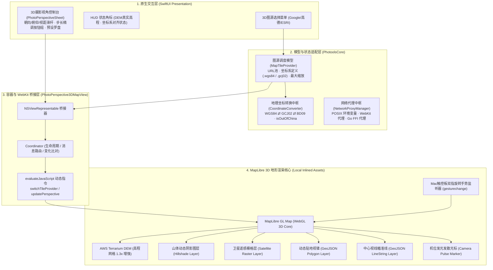
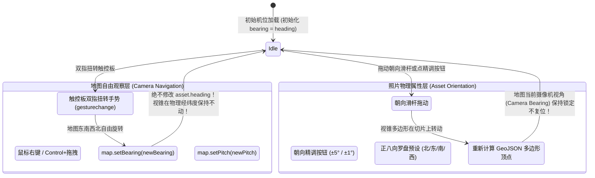

# 🏔️ photools 3D 真实地形摄影视角与多图源坐标系统设计 (PERSPECTIVE_3D_TERRAIN_ARCHITECTURE.md)

本文档详细规范 `photools` macOS 桌面端中 **3D 真实高程地形渲染、真实摄影机位视锥投射、多图源提供商免 Key 集成、WGS-84/GCJ-02
自适应坐标系映射、触控板自由手势与摄影姿态解耦、以及系统代理内核调度** 的完整技术架构与实现规范。

---

## 1. 核心设计背景与目标 (Background & Goals)

传统数字资产管理 (DAM) 工具或地图软件在展示摄影机位时，普遍存在以下致命痛点：

1. **地表扁平无起伏**：传统二维地图无法展示高山峡谷、雪山机位与山川脉络，摄影师无法直观判断视线是否被山体遮挡；
2. **底图加密形变导致机位漂移**：中国大陆公开发行的切片强制经过 GCJ-02 非线性形变，而相机 EXIF 为国际标准
   WGS-84，导致照片图钉在卫星底图上向东南漂移整整 600 余米；
3. **商业地图 Key 门槛与高昂账单**：Google / Mapbox 商业 API 要求绑定信用卡并受调用量限制；
4. **手势与摄影姿态混淆**：用户旋转地图查看地形时，误将地图旋转角度赋给照片拍摄朝向，破坏了照片原始朝向事实；
5. **代理与网络穿透限制**：部分企业或摄影师工作机未开启 TUN 虚拟网卡，导致外部高程切片和 Google 卫星请求被阻断。

**photools 3D 地形摄影视角系统的核心目标**：

- **真实立体呈现**：基于 MapLibre WebGL 引擎结合 AWS Terrarium DEM 高程数据，实时构建真实地貌 3D 起伏与山体立体阴影；
- **真实贴地视锥**：依据相机传感器尺寸、等效焦距、拍摄俯仰角与对焦视距，在 3D 地表上投射等比例贴地透视扇形；
- **全免 Key 多图源**：内置 Google 纯卫星、Google 混合地球、高德遥感卫星与 ESRI 全球遥感四大图源，100% 免 API Key；
- **零污染自适应纠偏**：原图 EXIF 严格保持 WGS-84 纯正物理坐标，仅在渲染层根据所选图源自适应对齐；
- **双层解耦手势中枢**：触控板双指扭转自由漫游旋转地图东南西北，照片角度严格锁定由滑杆与精调指示器控制；
- **系统代理内核调度**：集中管理代理配置，WebKit、Go FFI 引擎与外部子进程统一穿透。

---

## 2. 总体架构与渲染数据流 (System Architecture)



---

## 3. 多图源供应商与坐标系对齐矩阵 (Tile Providers & Coordinate Systems)

系统在 `PhotoolsCore/Models/MapTileProvider.swift` 中统一定义图源模型，将切片负载均衡池、最大缩放级别与底图坐标系紧密解耦内聚：

| 图源供应商          | 内部标识           | 底图坐标系              | 偏转算法与策略         | 大陆网络特性     | 典型适用场景                                        |
|:--------------------|:-------------------|:------------------------|:-----------------------|:-----------------|:----------------------------------------------------|
| **Google 纯卫星**   | `google_satellite` | **WGS-84** (真实物理)   | **零偏移 (原样透传)**  | 需系统代理       | 纯净无遮挡鸟瞰，图钉与视锥绝对精准对齐真实地物      |
| **Google 混合地球** | `google_hybrid`    | **WGS-84** (真实物理)   | **零偏移 (原样透传)**  | 需系统代理       | 卫星遥感叠加路网与地标注记，便于实地辨识拍摄物      |
| **高德遥感卫星**    | `autonavi`         | **GCJ-02** (国测局加密) | **自适应 GCJ-02 纠偏** | **国内直连免翻** | 境内网络秒级直连，自动向东南纠偏 630 米贴合切片     |
| **ESRI 全球遥感**   | `esri_satellite`   | **WGS-84** (真实物理)   | **零偏移 (原样透传)**  | **国内直连免梯** | ArcGIS 全球高清遥感，免代理直连且原生 WGS-84 零偏移 |

### 3.1 坐标渲染转换算法

```swift
public func renderCoordinate(for originalCoord: CLLocationCoordinate2D) -> CLLocationCoordinate2D {
    switch coordinateSystem {
    case .wgs84:
        // Google 与 ESRI 切片本身为纯正 WGS-84，直接以真实物理坐标渲染
        return originalCoord
    case .gcj02:
        // 高德切片为 GCJ-02，国内自动加偏对齐，境外保持 WGS-84
        return originalCoord.toGCJ02()
    }
}
```

### 3.2 免 API Key 瓦片规则与负载均衡

- **Google 瓦片服务**：采用 Google 标准 XYZ 栅格瓦片 `https://mt{0-3}.google.com/vt/lyrs={s|y}&x={x}&y={y}&z={z}`，客户端自动轮询
  `mt0~mt3` 四大子域并发拉取；
- **高德瓦片服务**：采用高德遥感切片 `https://webst0{1-4}.is.autonavi.com/appmaptile?style=6&x={x}&y={y}&z={z}`；
- **ESRI 瓦片服务**：采用 ArcGIS World
  Imagery `https://server.arcgisonline.com/ArcGIS/rest/services/World_Imagery/MapServer/tile/{z}/{y}/{x}`。

---

## 4. 触控板自由手势与摄影参数彻底解耦 (Gesture & Camera Decoupling)

为解决摄影师在三维地图自由旋转观察地形时破坏照片原始朝向的行业普遍难题，系统确立了**“双层解耦架构”**：



### 4.1 Mac 触控板原生手势接入

```javascript
let gestureStartBearing = 0;
let isGestureRotating = false;

window.addEventListener('gesturestart', function (e) {
    e.preventDefault();
    isGestureRotating = true;
    gestureStartBearing = map.getBearing();
}, {passive: false});

window.addEventListener('gesturechange', function (e) {
    e.preventDefault();
    if (!isGestureRotating || typeof e.rotation !== 'number') return;
    // e.rotation: 触控板双指旋转角度 (顺时针为正，单位为度)
    const targetBearing = (gestureStartBearing - e.rotation + 720) % 360;
    map.setBearing(targetBearing);
}, {passive: false});

window.addEventListener('gestureend', function (e) {
    e.preventDefault();
    isGestureRotating = false;
}, {passive: false});
```

### 4.2 视角更新条件保持机制 (`syncCameraBearing`)

在 Swift 与 JS 桥接通道中，引入 `syncCameraBearing` 裁决策略：

- **`syncCameraBearing = false`（默认模式）**：当用户调节朝向、视距、俯仰或视场角时，仅更新视锥多边形（GeoJSON）， **绝对不触碰地图当前的
  `map.bearing`**，摄影师调好的侧面或俯瞰观察视角平稳保留；
- **`syncCameraBearing = true`（对齐模式）**：仅在用户点击“正北朝上”、切换相机模式（第一人称 POV / 概览）或切换图源提供商时，才执行平滑镜头对齐。

---

## 5. 摄影参数三维精调系统 (Fine-Tuning Controls)

针对摄影师在微调照片视距与俯仰时的精度要求，底栏 HUD 提供了与朝向完全对称的微调交互：

### 5.1 视距自适应物理尺度精调 (Distance Adaptive Fine-Tuning)

视距采用对数非线性映射（15 米 ～ 12 公里），精调按钮根据当前绝对物理尺度自适应切换步长：

- **近景 ($< 100\text{m}$)**：步长 $\pm 10\text{m}$；
- **中景 ($100\text{m} \sim 500\text{m}$)**：步长 $\pm 25\text{m}$；
- **远景 ($500\text{m} \sim 2000\text{m}$)**：步长 $\pm 100\text{m}$；
- **超远景 ($> 2000\text{m}$)**：步长 $\pm 250\text{m}$；
- **一键对焦主体锚定**：若相机 EXIF 记录了物理对焦距离（`FocusDistance`），提供 `[主体 N m]` 快捷按钮，一键将视距精准锁定至拍摄主体。

### 5.2 俯仰角四键精调 (Pitch Fine-Tuning)

- `[-5°]`：俯冲降低 5°；
- `[-1°]`：俯冲降低 1°；
- `[+1°]`：仰角抬升 1°；
- `[+5°]`：仰角抬升 5°；
- 配合 0° ～ 75° 连续无死区滑杆，步进分辨率达 1°。

---

## 6. 离线内联加固与系统代理调度体系 (Offline & Proxy Architecture)

### 6.1 离线核心库内置 (0ms 零延迟启动)

- 将 `maplibre-gl.js`（784KB）与 `maplibre-gl.css`（64KB）内置于 App Bundle 内部 `Resources/maplibre/`；
- WebKit 初始化时直接内联注入，在断网、野外或弱网环境下 **0ms 瞬间完成引擎加载**，彻底摆脱 CDN 依赖。

### 6.2 全链路代理调度内核 (`NetworkProxyManager`)

```
[设置中心 SettingsView] ➔ [NetworkProxyManager 单例]
                                ├─► POSIX 环境变量 (HTTP_PROXY / ALL_PROXY) ➔ curl 与外部子进程
                                ├─► WebKit / URLSession ➔ connectionProxyDictionary (DEM与卫星切片)
                                └─► Go 核心引擎 FFI ➔ Photools_ApplyProxy (离线地理包下载与反查)
```

---

## 7. 质量保证与测试矩阵 (QA & Verification)

1. **单元测试矩阵 (`PhotoolsCoreTests/MapTileProviderTests.swift`)**：
    - 验证 4 大图源枚举与 URL 占位符完整性；
    - 验证坐标系分类（Google/ESRI 为 WGS-84，高德为 GCJ-02）；
    - 验证中国境内高德自动偏移、Google/ESRI 绝对原值输出；
    - 验证境外所有图源均原样输出 WGS-84 物理坐标。
2. **自动化测试执行**：
   ```bash
   swift test --package-path apps/macos/PhotoolsApp --filter MapTileProviderTests
   ```
